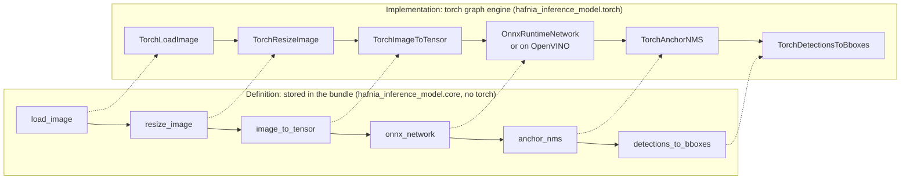

# hafnia-inference-model

**Model bundles**: a model stored as a zip with its files and a `model_info.json` that describes it as a
graph of components. This library writes bundles from pretrained models and trainer archives, converts them
(torch → ONNX → OpenVINO IR → INT8), and runs any bundle through one `InferenceModel` interface that always
returns Hafnia primitives, so models can be visualized, benchmarked and served the same way.

The Hafnia trainer package package-openvino installs it from this repository to export, convert and benchmark
bundles on the Hafnia platform. See [docs/design.md](docs/design.md) for the design
and decisions.

## Inside a bundle: definition and implementation

A bundle is a zip with the model files and a `model_info.json` that describes the model as a **graph of
components**. Each component reads and writes named items of one data dictionary. The bundle only
**defines** the graph, and the **torch graph engine** implements and runs it:



- A **component definition** (`hafnia_inference_model.core`) is a pydantic model for one component type: its fields
  are the parameters and it declares the ports (named inputs and outputs). `model_info.json` stores the type,
  the parameters and the data key of each port. A definition holds no implementation and needs no tensor
  library.
- The **torch graph engine** (`hafnia_inference_model.torch`) has an implementation of every definition and runs the
  graph. Components exchange `torch.Tensor`s, so a graph can run on the GPU from the image to the detections.
  Networks stored as ONNX or OpenVINO IR files run on ONNX Runtime or OpenVINO inside the same graph.

Converting a bundle (torch → ONNX → OpenVINO → INT8) replaces the network and keeps the rest. A new model
family is a new graph built from existing components. Running a graph needs torch, whatever format the network
has.

The export step for the two supported frameworks (torchvision and RF-DETR) is the `hafnia_inference_model.exporters` package. It
is the only part that depends on the frameworks, and in the concept it belongs on the trainer package side. A
bundle with a torch network needs `hafnia_inference_model.exporters` to rebuild the network, so the bundles that cross to
package-openvino are ONNX or OpenVINO bundles.

## Supported models

| Model | Task | Sources | Network | After the network |
|---|---|---|---|---|
| torchvision SSDLite320 MobileNetV3 | detection | pretrained | backbone, head, box decoding | per-class threshold, top-k and NMS |
| torchvision Faster R-CNN MobileNetV3 320 FPN | detection | pretrained | the full model incl. resize and NMS | score threshold |
| RF-DETR Nano / Small / Medium / Large | detection | pretrained, trainer-object-detection archive | RF-DETR's own export | sigmoid and top-k over queries and classes |
| torchvision ResNet18 | classification | pretrained, trainer-classification archive | the model | softmax, top-1 |

Each network runs on PyTorch (the source bundle), ONNX Runtime and OpenVINO (ONNX or IR in FP32, FP16 or INT8).

## Layout

One package, `hafnia_inference_model`, with a subpackage per concept. `from hafnia_inference_model import
ModelBundle, GraphInferenceModel` imports only `core`, which needs no torch and no inference engine.

| Package | Purpose |
|---|---|
| `hafnia_inference_model.core` | The bundle definition: `ModelBundle` (the model info schema, reading, writing and converting bundles as a folder or zip), component definitions (image loading, resize, tensor conversion, NMS, query top-k, primitives, ONNX and OpenVINO networks), the interface of a loaded graph (`GraphInferenceModel` with its latency benchmark, `load_graph`), and `AlignPredictionClasses`, the recipe transform that aligns prediction classes for Hafnia's accuracy benchmark. No implementations, torch free. |
| `hafnia_inference_model.torch` | The torch graph engine: `TorchModelGraph` (the executor), the implementations of the standard definitions in torch, the base classes of networks, and the converter torch → ONNX |
| `hafnia_inference_model.onnxruntime` | Runs `onnx_network` components on ONNX Runtime, inside the torch graph engine |
| `hafnia_inference_model.openvino` | Runs `openvino_network` (and on request `onnx_network`) components on OpenVINO, inside the torch graph engine. Converters ONNX → OpenVINO IR (FP32, FP16) and INT8 quantization (NNCF) |
| `hafnia_inference_model.exporters` | Model families: the definitions and torch implementations of the networks of torchvision SSD, Faster R-CNN and ResNet18 and of RF-DETR, and the functions that write their bundles from pretrained models and trainer archives |

## Examples

| Example | Shows |
|---|---|
| `examples/example_inference_model.py` | The basic flow: torchvision → model bundle → ONNX bundle, run it with ONNX Runtime, convert to OpenVINO, run it with OpenVINO (same loading and `predict` code for both engines), draw the predictions, and run Hafnia's benchmark |
| `examples/example_compare_models.py` | SSDLite320, Faster R-CNN and RF-DETR Nano on PyTorch, ONNX Runtime and OpenVINO (ONNX, IR FP32, IR FP16, IR INT8) in one loop, with Hafnia's benchmark (mAP) and latency in a table |

```bash
uv run python examples/example_inference_model.py  # Outputs go to .data/examples/
uv run python examples/example_compare_models.py
```

## Micro datasets

Tests and examples use small copies of Hafnia platform datasets stored in `tests/data`, so they run offline.
`tests/micro_datasets.py` defines them (source dataset, number of samples, seed) and creates them from the
platform. Creating them needs a Hafnia profile with a valid API key; tests create a missing micro dataset
automatically.

| Micro dataset | Source | Samples |
|---|---|---|
| `micro-coco-2017` | `coco-2017-tiny` 1.0.0 (20 samples) | 8, seed 0 |

The images and annotations of `micro-coco-2017` come from [COCO](https://cocodataset.org) (annotations
CC BY 4.0, images under their Flickr licenses).

```bash
uv run python tests/micro_datasets.py          # Create missing micro datasets
uv run python tests/micro_datasets.py --force  # Recreate all of them
```

## Development

```bash
uv sync --all-extras         # Install with all extras and the dev group
uv run pytest                # Run all tests (the first run downloads pretrained torchvision weights)
uv run pytest -m "not slow"  # Skip the end-to-end export tests
uv run pytest tests/test_openvino  # Tests of one subpackage (one folder per subpackage)
uv run ruff check src tests examples          # Lint
uv run ruff format src tests examples         # Format
uv run mypy src tests examples                # Type check
```

## Usage

```python
from hafnia.dataset.benchmark.benchmark import run_benchmark

from hafnia_inference_model import GraphInferenceModel, ModelBundle
from hafnia_inference_model.core import AlignPredictionClasses

# Write a pretrained model as a bundle with a torch network, and convert it
print(ModelBundle.list_pretrained())  # The names. A model only needs the dependencies of its own framework
bundle = ModelBundle.from_pretrained("ssdlite320_mobilenet_v3_large", "model_torch.zip")  # Writes and returns it
bundle = ModelBundle.from_path("model_torch.zip")  # Or read a bundle: a folder or a zip
bundle_onnx = bundle.convert("onnx", "model_onnx.zip")  # Writes the new bundle and returns it
bundle_onnx.convert("openvino", "model_openvino.zip")  # Or options={"precision": "fp16"}
bundle_onnx.convert(
    "openvino_int8",
    "model_int8.zip",
    calibration_inputs=[{"image": path} for path in calibration_image_paths],
)

# A bundle is the description in model_info.json plus the place of its files
print(bundle_onnx.path, [f"{c.name} ({c.type})" for c in bundle_onnx.graph.components])
bundle_onnx.write("model_onnx_dir")  # As a folder
bundle_onnx.write("model_onnx_copy.zip")  # As a zip: a path ending with '.zip'

# Run any bundle: the graph in model_info.json says how
model = GraphInferenceModel.from_bundle(bundle_onnx)  # A bundle you already hold
model = GraphInferenceModel.from_path("model_onnx.zip")  # Or a bundle folder or zip
model = GraphInferenceModel.from_path(
    "model_onnx.zip",
    inference_engine="openvino",  # Optional: run the ONNX network on OpenVINO
    params={"score_threshold": 0.3},  # Optional: override component parameters ("nms.score_threshold" for one)
    device="CPU",  # "CUDA" runs the torch components and an ONNX Runtime network on the GPU
)
primitives = model.predict(image)  # List[Primitive], e.g. Bbox predictions

# Benchmarks: Hafnia's metrics on a Hafnia dataset, and latency per component (e.g. 'network_p90_ms').
# AlignPredictionClasses matches the prediction classes to the dataset's by name: it removes additional
# classes (e.g. COCO models have 91 classes, 'coco-2017' 80) and puts the classes in the dataset's order
metrics, dataset_predictions = run_benchmark(dataset, model, recipe_transforms=[AlignPredictionClasses()])
latency = model.measure_latency(images, batch_size=1)

# Intermediate values of the graph (torch tensors)
network_outputs = model.graph.run({"image": image}, outputs=["anchor_boxes", "anchor_scores"])

# A definition describes a component and connects it into a graph. It computes nothing itself
from hafnia_inference_model.core.definitions import ResizeImage

resize = ResizeImage(mode="letterbox", height=320, width=320)
info = resize.connect("resize", inputs={"image": "image_rgb"}, outputs={"image": "resized", "transform": "t"})

# The torch implementations are functions on tensors, which also run on their own
from hafnia_inference_model.torch.components.image import load_image_rgb, resize_image

resized, transform = resize_image(load_image_rgb(image), mode="letterbox", height=320, width=320)
```
