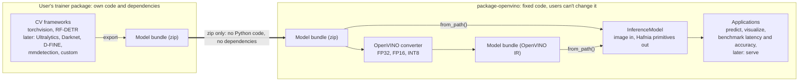
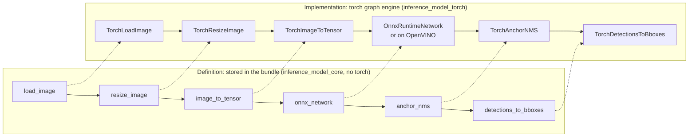

# package-openvino

A Hafnia trainer package for **generic model export and inference**. It does no training. Instead it
converts models to OpenVINO and runs them through one shared `InferenceModel` interface that always
returns Hafnia primitives, so models can be visualized, benchmarked and served the same way.

## Concept

### Two environments, one model bundle



- **A user's trainer package** trains a model with a CV framework of the user's choice. It holds the user's
  code and dependencies, and exports the model as a **model bundle**.
- **Only the bundle crosses** to this package: no Python code and no dependencies. Loading a bundle never
  runs code from it.
- **This package is fixed code**, the same for every model. It converts a bundle to OpenVINO and loads any
  bundle as an `InferenceModel` with `GraphInferenceModel.from_path()` or `from_bundle()`. An `InferenceModel`
  takes an image and returns Hafnia primitives, so predicting, visualizing and benchmarking are shared by all
  models.

Where the code is today: the export step for the two supported frameworks (torchvision and RF-DETR) is the
`model_exporters` package in this repository. It is the only part that depends on the frameworks, and in the
concept it belongs on the trainer package side. A bundle with a torch network needs `model_exporters` to
rebuild the network, so the bundles that cross the line are ONNX or OpenVINO bundles.

### Inside a bundle: definition and implementation

A bundle is a zip with the model files and a `model_info.json` that describes the model as a **graph of
components**. Each component reads and writes named items of one data dictionary. The bundle only
**defines** the graph, and the **torch graph engine** implements and runs it:



- A **component definition** (`inference_model_core`) is a pydantic model for one component type: its fields
  are the parameters and it declares the ports (named inputs and outputs). `model_info.json` stores the type,
  the parameters and the data key of each port. A definition holds no implementation and needs no tensor
  library.
- The **torch graph engine** (`inference_model_torch`) has an implementation of every definition and runs the
  graph. Components exchange `torch.Tensor`s, so a graph can run on the GPU from the image to the detections.
  Networks stored as ONNX or OpenVINO IR files run on ONNX Runtime or OpenVINO inside the same graph.

Converting a bundle (torch → ONNX → OpenVINO → INT8) replaces the network and keeps the rest. A new model
family is a new graph built from existing components. Running a graph needs torch, whatever format the network
has.

See [docs/design.md](docs/design.md) for the design and decisions.

## Supported models

| Model | Task | Sources | Network | After the network |
|---|---|---|---|---|
| torchvision SSDLite320 MobileNetV3 | detection | pretrained | backbone, head, box decoding | per-class threshold, top-k and NMS |
| torchvision Faster R-CNN MobileNetV3 320 FPN | detection | pretrained | the full model incl. resize and NMS | score threshold |
| RF-DETR Nano / Small / Medium / Large | detection | pretrained, trainer-object-detection archive | RF-DETR's own export | sigmoid and top-k over queries and classes |
| torchvision ResNet18 | classification | pretrained, trainer-classification archive | the model | softmax, top-1 |

Each network runs on PyTorch (the source bundle), ONNX Runtime and OpenVINO (ONNX or IR in FP32, FP16 or INT8).

## Layout

Each top-level package under `src/` is a separate concept that can later move to its own repo:

| Package | Purpose |
|---|---|
| `inference_model_core` | The bundle definition: `ModelBundle` (the model info schema, reading, writing and converting bundles as a folder or zip), component definitions (image loading, resize, tensor conversion, NMS, query top-k, primitives, ONNX and OpenVINO networks), and the interface of a loaded graph (`GraphInferenceModel`, `load_graph`). No implementations, torch free. |
| `inference_model_torch` | The torch graph engine: `TorchModelGraph` (the executor), the implementations of the standard definitions in torch, the base classes of networks, and the converter torch → ONNX |
| `inference_model_onnxruntime` | Runs `onnx_network` components on ONNX Runtime, inside the torch graph engine |
| `inference_model_openvino` | Runs `openvino_network` (and on request `onnx_network`) components on OpenVINO, inside the torch graph engine. Converters ONNX → OpenVINO IR (FP32, FP16) and INT8 quantization (NNCF) |
| `model_exporters` | Model families: the definitions and torch implementations of the networks of torchvision SSD, Faster R-CNN and ResNet18 and of RF-DETR, and the functions that write their bundles from pretrained models and trainer archives |
| `package_openvino` | Trainer glue: checkpoint and dataset loading, latency per component, metrics, class mappings |

## Scripts

| Script | Purpose |
|---|---|
| `scripts/export_to_onnx.py` | Export a trainer archive (checkpoint or `--model-path`) or a pretrained model (`--model-name`) to an ONNX bundle in the experiment model folder |
| `scripts/export_onnx_to_openvino.py` | Convert an ONNX bundle (checkpoint or `--model-path`) to an OpenVINO IR bundle: FP32, FP16 or INT8 (calibrated on a Hafnia dataset) |
| `scripts/benchmark.py` | Accuracy (Hafnia metrics, optional class mappings) and latency per component (e.g. resize, network, NMS) of any bundle on any engine and device |

## Examples

| Example | Shows |
|---|---|
| `examples/example_inference_model.py` | The basic flow: torchvision → model bundle → ONNX bundle, run it with ONNX Runtime, convert to OpenVINO, run it with OpenVINO (same loading and `predict` code for both engines), draw the predictions, and run Hafnia's benchmark |
| `examples/example_compare_models.py` | SSDLite320, Faster R-CNN and RF-DETR Nano on PyTorch, ONNX Runtime and OpenVINO (ONNX, IR FP32, IR FP16, IR INT8) in one loop, with Hafnia's benchmark (mAP) and latency in a table |

```bash
uv run python examples/example_inference_model.py  # Outputs go to .data/examples/
uv run python examples/example_compare_models.py
```

## Micro datasets

Tests and examples use small copies of Hafnia platform datasets stored in `tests/data`, so they run offline.
`tests/micro_datasets.py` defines them (source dataset, number of samples, seed) and creates them from the
platform. Creating them needs a Hafnia profile with a valid API key; tests create a missing micro dataset
automatically.

| Micro dataset | Source | Samples |
|---|---|---|
| `micro-coco-2017` | `coco-2017-tiny` 1.0.0 (20 samples) | 8, seed 0 |

```bash
uv run python tests/micro_datasets.py          # Create missing micro datasets
uv run python tests/micro_datasets.py --force  # Recreate all of them
```

## Trainer package

```bash
hafnia trainer create-zip .           # -> trainer.zip (see .hafniaignore)
hafnia runc build-local trainer.zip   # -> Docker image, its tag in state.json
```

`hafnia runc launch-local` mounts only the dataset and needs the NVIDIA container runtime. To test a script
that takes an input bundle, run the image like the platform does, with the checkpoint, model and output
folders mounted (here the bundle from `.data/runs/1/model` is the checkpoint of run 2):

```bash
IMAGE=$(python -c "import json; print(json.load(open('state.json'))['image_tag'])")
mkdir -p .data/runs/2/checkpoints && cp .data/runs/1/model/*.zip .data/runs/2/checkpoints/
docker run --rm -e HAFNIA_CLOUD=true -e PYTHONPATH=src \
  -v "$PWD/tests/data/micro-coco-2017:/opt/ml/input/data/training:ro" \
  -v "$PWD/.data/runs/2/checkpoints:/opt/ml/checkpoints" \
  -v "$PWD/.data/runs/2/model:/opt/ml/model" \
  -v "$PWD/.data/runs/2/output:/opt/ml/output/data" \
  "$IMAGE" python scripts/export_onnx_to_openvino.py --precision int8 --calibration-split-name all
```

## Development

```bash
uv sync --all-extras         # Install dependencies incl. torch, rfdetr, onnxruntime, openvino and the dev group
uv run pytest                # Run all tests (the first run downloads pretrained torchvision weights)
uv run pytest -m "not slow"  # Skip the end-to-end export tests
uv run pytest tests/inference_model_openvino  # Tests of one module (one folder per module under src/)
uv run ruff check src tests scripts examples  # Lint
uv run ruff format src tests scripts examples # Format
uv run mypy src tests scripts examples        # Type check
```

## Usage

```bash
# Export a pretrained model to an ONNX bundle (default: SSDLite320)
python scripts/export_to_onnx.py
python scripts/export_to_onnx.py --model-name RFDETRNano

# Export a trainer-classification or trainer-object-detection model archive (e.g. a platform checkpoint)
python scripts/export_to_onnx.py --model-path ../trainer-classification/pretrained_models/resnet18.zip

# Convert an ONNX bundle to OpenVINO IR (FP32 by default, or --precision fp16)
python scripts/export_onnx_to_openvino.py --model-path ssdlite320_mobilenet_v3_large_onnx.zip

# INT8 quantization, calibrated on a Hafnia dataset ('name:version' or a dataset folder)
python scripts/export_onnx_to_openvino.py --model-path ssdlite320_mobilenet_v3_large_onnx.zip --precision int8 \
    --calibration-dataset coco-2017:1.0.0

# Benchmark accuracy and latency of any bundle (here an ONNX bundle run on OpenVINO)
python scripts/benchmark.py --model-path ssdlite320_mobilenet_v3_large_onnx.zip --inference-engine openvino
```

```python
from inference_model_core import GraphInferenceModel, ModelBundle

# Write a pretrained model as a bundle with a torch network, and convert it
print(ModelBundle.list_pretrained())  # The names. A model only needs the dependencies of its own framework
bundle = ModelBundle.from_pretrained("ssdlite320_mobilenet_v3_large", "model_torch.zip")  # Writes and returns it
bundle = ModelBundle.from_path("model_torch.zip")  # Or read a bundle: a folder or a zip
bundle_onnx = bundle.convert("onnx", "model_onnx.zip")  # Writes the new bundle and returns it
bundle_onnx.convert("openvino", "model_openvino.zip")  # Or options={"precision": "fp16"}
bundle_onnx.convert(
    "openvino_int8",
    "model_int8.zip",
    calibration_inputs=[{"image": path} for path in calibration_image_paths],
)

# A bundle is the description in model_info.json plus the place of its files
print(bundle_onnx.path, [f"{c.name} ({c.type})" for c in bundle_onnx.graph.components])
bundle_onnx.write("model_onnx_dir")  # As a folder
bundle_onnx.write("model_onnx_copy.zip")  # As a zip: a path ending with '.zip'

# Run any bundle: the graph in model_info.json says how
model = GraphInferenceModel.from_bundle(bundle_onnx)  # A bundle you already hold
model = GraphInferenceModel.from_path("model_onnx.zip")  # Or a bundle folder or zip
model = GraphInferenceModel.from_path(
    "model_onnx.zip",
    inference_engine="openvino",  # Optional: run the ONNX network on OpenVINO
    params={"score_threshold": 0.3},  # Optional: override component parameters ("nms.score_threshold" for one)
    device="CPU",  # "CUDA" runs the torch components and an ONNX Runtime network on the GPU
)
primitives = model.predict(image)  # List[Primitive], e.g. Bbox predictions

# Intermediate values of the graph (torch tensors)
network_outputs = model.graph.run({"image": image}, outputs=["anchor_boxes", "anchor_scores"])

# A definition describes a component and connects it into a graph. It computes nothing itself
from inference_model_core.definitions import ResizeImage

resize = ResizeImage(mode="letterbox", height=320, width=320)
info = resize.connect("resize", inputs={"image": "image_rgb"}, outputs={"image": "resized", "transform": "t"})

# The torch implementations are functions on tensors, which also run on their own
from inference_model_torch.components.image import load_image_rgb, resize_image

resized, transform = resize_image(load_image_rgb(image), mode="letterbox", height=320, width=320)
```
