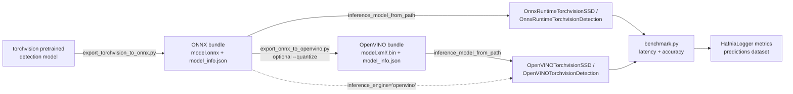

# package-openvino: Generic Model Export and Inference

Status: design agreed and reviewed (2026-11-18); see [section 11](#11-decisions). Implementation steps 1–6 done: package scaffold, `src/inference_model_core`, torchvision → ONNX export, the ONNX Runtime flavors, the OpenVINO flavors, ONNX → OpenVINO conversion, INT8 quantization and the benchmark script.
Scope: the `package-openvino` trainer package, built locally next to `../hafnia`,
`../trainer-object-detection` and `../trainer-classification`.

---

## 1. What we are trying to do

Today each trainer package (RF-DETR detection, ResNet classification) owns its own model
wrapper, its own zip format and its own export/benchmark scripts. Nothing outside a trainer
package knows how to open or run its model archive.

The goal is to turn that around:

1. **A user uploads a model** (from a supported framework and file format) together with a
   description of the model.
2. **We can convert it** to OpenVINO IR, optionally quantized to INT8.
3. **We can run it** with OpenVINO (and ONNX Runtime, and later TensorRT) through **one
   common interface** that always returns Hafnia primitives (`Bbox`, `Bitmask`,
   `Classification`, ...).
4. Because the output is always Hafnia primitives, **everything downstream is shared**:
   visualization, benchmarking (latency + accuracy), and serving.

Two things have to be standardized to make this work:

- **The inference interface**: an `InferenceModel` base class with a fixed set of methods.
- **The storage format**: a model bundle (one zip) holding the serialized model plus a
  machine-readable description, "model info", that says how to run it and what it returns.

For this first iteration everything lives in one trainer package, `package-openvino`. It does
**no training**. Its scripts are generic: they work on any model bundle whose flavor is
installed, not on one specific architecture.

---

## 2. Where we start from (what already exists)

| Thing | Where | Notes |
|---|---|---|
| `InferenceModel` ABC | `hafnia/src/hafnia/dataset/benchmark/inference_model.py` | `predict(image, sample_dict) -> List[Primitive]`, `predict_batch(...)` (default loops over `predict`), `get_model_info() -> ModelInfo`. No load/save, no raw predict. |
| `ModelInfo` | `hafnia/src/hafnia/dataset/hafnia_dataset_types.py:547` | Subclass of `TasksInfo`: `tasks`, `name`, `version`, `description`, reference URLs, free-form `meta`. Nothing about format, engine, files, pre/post-processing. |
| `TaskInfo` / `ClassInfo` | same file, `:91` | Primitive type + ordered list of unique class names + task name. Serializes the primitive as a string, which works well for JSON. |
| Benchmark | `hafnia/src/hafnia/dataset/benchmark/benchmark.py` | `run_inference_on_dataset` / `run_benchmark` work on any `InferenceModel` and compute accuracy metrics (mAP etc.). **They don't measure latency.** |
| RF-DETR wrapper | `trainer-object-detection/src/trainer_object_detection/wrapped_model.py` | Zip = `model_config.json` + weights. Config is RF-DETR specific (`InitModelConfig`). |
| ResNet wrapper | `trainer-classification/src/trainer_classification/wrapped_model.py` | Same zip pattern, own `ModelConfig`. |
| OpenVINO export | `trainer-object-detection/scripts/export_openvino.py` | RF-DETR → temporary ONNX → `ov.convert_model` → optional NNCF INT8 PTQ (calibrated on a Hafnia dataset) → writes OpenVINO Model API `rt_info` (mean/scale, resize type, labels) for DLStreamer. |
| Benchmark script | `trainer-object-detection/scripts/benchmark.py` | Loads dataset (hidden dataset on platform, sample locally), picks up checkpoint from `MDI_CHECKPOINT_DIR`, optional class mapping, logs metrics through `HafniaLogger`. |
| Platform conventions | `HafniaLogger`, `hafnia.utils` | Input model = `*.zip` in `logger.path_model_checkpoints()`; output = `logger.path_model()`; dataset via `get_dataset_path_in_hafnia_cloud()` when `HAFNIA_CLOUD=true`. |

Takeaways:

- The **zip with a JSON description** is already the de-facto pattern in both trainers. We
  generalize it rather than invent something new.
- The existing OpenVINO exporter already writes pre-processing metadata into the IR. That
  is the same idea as "model info", but stored in OpenVINO-specific form. We should produce
  that `rt_info` as a by-product of our own model info, so Intel tooling (Model API,
  DLStreamer, OVMS) keeps working.
- The quantization code is mostly generic already. The only RF-DETR specific part is the
  calibration preprocessing. Once preprocessing is described in model info, calibration
  becomes generic too.

---

## 3. Core concepts

### 3.1 Model bundle (storage format)

A model bundle is a **single zip file** (so it fits the existing "checkpoint is a zip"
platform convention) with a fixed entry point:

```
ssdlite320_openvino_int8.zip
├── model_info.json        # always present, always this name
├── model.xml              # file_path from model_info points here
└── model.bin              # companion file listed in extra_files
```

```
ssdlite320_onnx.zip
├── model_info.json
└── model.onnx             # (+ model.onnx.data if weights are stored externally)
```

Rules:

- `model_info.json` at the root describes everything else. Paths inside it are relative to
  the bundle root.
- A model can be more than one file (OpenVINO IR is always `.xml` + `.bin`, large ONNX models
  have external data). So we need `file_path` (the entry file) **plus** `extra_files`.
- Loaders should accept **either the zip or an already extracted directory**. This avoids
  temp-dir handling in serving and allows fast local iteration.
- Only non-executable formats (ONNX, OpenVINO IR, later TensorRT engines and `torch.export`
  `.pt2`) are allowed. No pickled `state_dict`/`torch.save` objects in user uploads.

### 3.2 Model info (the description inside the bundle)

Model info answers three questions:

1. **What is it?** Name, framework, variant, tasks/classes. This doesn't change when the model
   is converted.
2. **How is it stored and run?** Format, engine, files, input tensor spec, precision. This
   changes with every export.
3. **How do I get from an image to tensors and from tensors to primitives?** Pre- and
   post-processing.

The list from the brief maps onto these as follows:

| Brief | Proposed field | Group |
|---|---|---|
| Model input (image/video) | `runtime.input.modality` | runtime |
| Model tasks | `tasks: List[TaskInfo]` (already on `ModelInfo`) | identity |
| Model framework | `framework` (`torchvision`, `rfdetr`, `ultralytics`, ...) | identity |
| Model type (nano, large, ...) | `variant` (decided in Q3, section 11) | identity |
| Model format | `runtime.model_format` (`onnx`, `openvino`, `pt2`, `tensorrt`) | runtime |
| file_path | `runtime.file_path` (+ `runtime.extra_files`) | runtime |
| Inference engine | `runtime.inference_engine` (`onnxruntime`, `openvino`, ...) | runtime |
| Preprocessing steps | `runtime.preprocessing` | runtime |
| Postprocessing steps | `runtime.postprocessing` | runtime |
| *(not in brief)* | `format_version` | top level, so the schema can evolve |
| *(not in brief)* | `runtime.precision` (`fp32`/`fp16`/`int8`) | runtime |
| *(not in brief)* | `runtime.provenance` (parent bundle, tool versions, quantization settings) | runtime |

Note that **format and engine are separate on purpose**. An `.onnx` file can run on ONNX
Runtime, on OpenVINO (it reads ONNX directly) and on TensorRT. The engine decides which flavor
loads the model. The format describes the files.

### 3.3 Pre- and post-processing: config vs code

This is the hardest design question. The two halves behave differently.

**Pre-processing is mostly declarative.** Almost every vision model does some combination of:
decode → color order (RGB/BGR) → resize (stretch / letterbox / keep-ratio + pad / none) →
scale (÷255) → normalize (mean/std) → layout (HWC→CHW) → dtype → batch. We can describe this
as a small typed spec, and implement it **once**, in NumPy/OpenCV, shared by all flavors.

Pre-processing must also return **per-image metadata** (original size, scale factors,
padding). Post-processing needs it to map boxes and masks back to normalized coordinates on the
original image, which is what Hafnia primitives use.

Some models already contain pre-processing inside the graph. Exported torchvision detection
models resize and normalize internally, and OpenVINO can embed steps with `PrePostProcessor`.
The spec needs a way to say "this step is already in the graph".

**Post-processing is mostly code.** Decoding outputs is model-family specific:

- torchvision detection ONNX → `boxes` (pixel xyxy), `labels`, `scores`, with NMS already in the graph
- RF-DETR → `pred_logits` + `pred_boxes` (normalized cxcywh), sigmoid, top-k, background index = last
- YOLO → raw anchors that need NMS
- classification → logits that need softmax/argmax

Trying to express all of that declaratively becomes a mini language. Instead:

- `postprocessing.decoder`: a **named** decoder (e.g. `"torchvision_detection"`,
  `"rfdetr_detection"`, `"classification_softmax"`), which selects code.
- `postprocessing.params`: the decoder's **parameters** (score threshold, NMS IoU, max
  detections, box format, output tensor names, background index, label offset, ...).

Rule of thumb: **model info holds configuration, the flavor holds code.** A model info file
should never need to contain executable logic.

### 3.4 Flavors

A **flavor** is a concrete `InferenceModel` subclass for one *(inference engine × model
family)* combination. All models of the same family share one flavor, whatever their size
(e.g. every torchvision SSD/Faster R-CNN detection model exported the same way).

**Decision: flavors are independent classes per engine** (Q4), as described in the brief.
Each engine package implements its own flavors: load, save, `predict_raw` and the family's
postprocessing. The engine packages share nothing except the core module.

```
inference_model_onnxruntime/flavors.py  -> OnnxRuntimeTorchvisionSSD, OnnxRuntimeTorchvisionDetection
inference_model_openvino/flavors.py     -> OpenVINOTorchvisionSSD, OpenVINOTorchvisionDetection (step 4)
```

**Preprocessing has one implementation** (design review, point 3):
`InferenceModelBase.preprocess()` defaults to `preprocess_model_input()`, which is driven by
`PreprocessingInfo`. Exporters use the same function for quantization calibration, so
calibration always sees the inputs the model sees at inference. Flavors override `preprocess()`
only for a stated reason.

Postprocessing is duplicated per engine. We accept that in return for engine repos that are
fully self-contained. Two things keep it in check:

- The core module provides **optional, engine-agnostic helpers**: NMS and per-class candidate
  selection (`detection.py`, matching torchvision's semantics), label mapping, and box conversion
  to normalized Hafnia primitives (`primitives.py`). A flavor's `postprocess` is then about
  15 lines.
- **Cross-engine parity tests** check that the ORT and OpenVINO flavors of the same family
  return the same primitives for the same bundle. That catches the two copies drifting apart.

Constraint: **flavors and core helpers must not depend on torch.** An OpenVINO serving image
shouldn't need PyTorch. Pre/post-processing uses NumPy (and OpenCV/Pillow for resizing).

### 3.5 Dispatch: `inference_model_from_path()`

```python
model = inference_model_from_path("ssdlite320_onnx.zip")                                  # bundle's default engine
model = inference_model_from_path("ssdlite320_onnx.zip", inference_engine="openvino")     # same ONNX file on OpenVINO
model = inference_model_from_path("ssdlite320_onnx.zip", postprocessing_params={"score_threshold": 0.5}, device="CPU")
primitives = model.predict(image)
```

1. Read only `model_info.json` from the zip or directory.
2. Build the registry key `(inference_engine, framework, decoder)`. The engine is the caller's
   `inference_engine`, or else the bundle's `runtime.inference_engine`, which is only a
   **default** (design review, point 2).
3. Look up the flavor class and check that it supports the bundle's `model_format`
   (`supported_formats`, e.g. `("onnx", "openvino")` for OpenVINO).
4. Call `FlavorClass.load_model(path, postprocessing_params=..., **engine_options)`.
5. If nothing matches, raise a clear error that names the key and the installed flavors.

Registry mechanics: flavors register with the `@register_flavor` class decorator when their
module is imported. Modules are imported through the **entry point** group
`hafnia.inference_models`, which `pyproject.toml` already uses for the in-repo ONNX Runtime
flavors. Installing a separate `inference-model-openvino` package later makes its flavors
discoverable with no central list to edit.

Two kinds of load-time settings, neither stored in the bundle:

- **Engine options** such as `device` (`CPU`/`GPU`/`NPU`/`AUTO`) and number of threads. The same
  bundle should run on different hardware.
- **Postprocessing overrides** such as `score_threshold`. The model info holds the defaults.
  Each flavor validates the merged parameters with a typed pydantic model (`params_model`), so a
  misspelled parameter is an error rather than silently ignored.

---

## 4. The `InferenceModel` interface

### 4.1 Corrections to the brief

The descriptions of `write_model` and `load_model` look swapped in the brief. Proposed meaning:

| Method | Kind | Purpose |
|---|---|---|
| `load_model(path, **runtime_options)` | classmethod | Bundle (zip or dir) → ready-to-run instance |
| `write_model(path)` | instance | Instance → bundle (zip or dir) |
| `predict_raw(inputs)` | instance | Engine-native tensors in → engine-native tensors out. No pre/post-processing. |
| `predict_raw_batch(inputs)` | instance | Same, for a batch (see 4.3) |
| `predict(image, sample_dict=None)` | instance | Image → `List[Primitive]` |
| `predict_batch(images, sample_dicts=None)` | instance | Images → `List[List[Primitive]]` |
| `get_model_info()` | instance | Returns **`ModelInfo`** (which contains `tasks: List[TaskInfo]`) |

`get_model_info` should keep returning `ModelInfo`, as the Hafnia method does today. Returning
only `List[TaskInfo]` would break `run_inference_on_dataset`, which calls
`model.get_model_info().tasks`.

### 4.2 Shape of the base class

Implemented in `src/inference_model_core/inference_model.py` as `InferenceModelBase`. It
**extends** Hafnia's `InferenceModel`, so `hafnia.dataset.benchmark` keeps working unchanged.
`predict` / `predict_batch` are fixed template methods. Pre- and post-processing work on
**one image at a time**. Only the engine call is batched:

```python
RawTensors = Dict[str, np.ndarray]  # keyed by graph input/output name

class InferenceModelBase(hafnia.InferenceModel):
    inference_engine: ClassVar[str]   # flavor key, used by @register_flavor
    framework: ClassVar[str]          # framework and decoder are checked against the model info
    decoder: ClassVar[str]
    supported_formats: ClassVar[Tuple[str, ...]]   # bundle formats the engine can load
    params_model: ClassVar[Type[BaseModel]]        # typed decoder parameters
    model_info: ModelBundleInfo
    params: BaseModel   # model info defaults merged with load-time 'postprocessing_params'

    # --- storage -----------------------------------------------------------
    @classmethod
    @abstractmethod
    def load_model(cls, path_bundle, postprocessing_params=None, **engine_options) -> Self: ...
    @abstractmethod
    def write_model(self, path_bundle, overwrite=False) -> Path: ...

    # --- engine part (implemented by each flavor) ---------------------------
    @abstractmethod
    def predict_raw(self, inputs: RawTensors) -> RawTensors: ...        # one image
    def predict_raw_batch(self, inputs: RawTensors) -> RawTensors: ...  # batch on axis 0, default: predict_raw
    def supports_batching(self) -> bool: ...  # default: rank-4 input with dynamic axis 0

    # --- model-family part --------------------------------------------------
    def preprocess(self, image: ImageType) -> Tuple[RawTensors, PreprocessMeta]: ...  # default: preprocess_model_input
    @abstractmethod
    def postprocess(self, outputs: RawTensors, meta: PreprocessMeta) -> List[Primitive]: ...
    def collate_raw_inputs(self, inputs: List[RawTensors]) -> RawTensors: ...                # concat on axis 0
    def split_raw_outputs(self, outputs: RawTensors, batch_size: int) -> List[RawTensors]: ...  # slice axis 0

    # --- fixed pipeline ----------------------------------------------------
    def predict(self, image, sample_dict=None):
        inputs, meta = self.preprocess(image)
        return self.postprocess(self.predict_raw(inputs), meta)

    def predict_batch(self, images, sample_dicts=None):
        # preprocess each image -> if supports_batching(): collate, predict_raw_batch, split
        #                       -> else: predict_raw per image
        # -> postprocess each image
        ...

    def get_model_info(self) -> ModelBundleInfo:
        return self.model_info
```

Why per-image pre/post-processing: the input and output tensors of a single image depend on the
graph. For example, torchvision detection takes a rank-3 `[3, H, W]` input and returns
`[N, 4]` boxes with no batch axis. Keeping pre/post-processing per image means
`postprocess` always sees exactly what `predict_raw` returns for one image, whether or not the
engine call was batched. The base class guarantees that `split_raw_outputs` gives the same shapes
as a single-image `predict_raw` call.

Because the pipeline is split into explicit stages, **the benchmark can time each stage
separately** (pre / inference / post) by calling the stages itself, without the flavor doing
anything extra.

### 4.3 "Native tensors" and batching

- "Native" means different things per engine (`ov.Tensor`, ORT `OrtValue`, CUDA buffers for
  TensorRT). For ONNX Runtime and OpenVINO, **`Dict[str, np.ndarray]` keyed by graph
  input/output name** is accepted directly by both and is easy to test against each other.
  We use that as the raw contract now, and revisit when TensorRT needs zero-copy device
  buffers.
- Batching depends on the exported graph. `supports_batching()` is true by default only for a
  rank-4 input with a dynamic batch axis. Static batch=1 graphs and torchvision detection
  (rank-3 input) fall back to one `predict_raw` call per image. Flavors can override it.
- Images in a batch have different sizes. Pre-processing resizes each image to the model
  input size before they are concatenated. The per-image `PreprocessMeta` keeps the original
  size, scale and padding for post-processing.

---

## 5. Proposed `ModelInfo` / `TaskInfo` changes

> Implemented as `ModelBundleInfo(ModelInfo)` in `src/inference_model_core/model_info.py`. Unlike the sketch below, `framework` and `runtime` are **required** there, since every bundle must be loadable by a flavor. The flavor key is `ModelBundleInfo.flavor_key()`.

Recommendation: keep `ModelInfo` backward compatible and add a nested, optional `runtime`
section. Identity fields stay at the top. Everything an export rewrites lives in `runtime`,
so an ONNX → OpenVINO export copies the model info and replaces only `runtime`.

```python
class ResizeInfo(BaseModel):
    mode: Literal["stretch", "letterbox", "keep_ratio_pad", "none"]
    height: Optional[int] = None          # None -> taken from input shape
    width: Optional[int] = None
    interpolation: Literal["linear", "nearest", "cubic"] = "linear"
    pad_value: float = 0.0

class PreprocessingInfo(BaseModel):
    color_order: Literal["RGB", "BGR"] = "RGB"
    resize: Optional[ResizeInfo] = None
    scale: Optional[float] = 1 / 255      # pixel multiplier before normalization
    mean: Optional[List[float]] = None
    std: Optional[List[float]] = None
    layout: Literal["NCHW", "NHWC"] = "NCHW"
    dtype: Literal["float32", "float16", "uint8"] = "float32"
    in_graph: List[str] = []              # steps already performed inside the model graph

class PostprocessingInfo(BaseModel):
    decoder: str                          # selects code, e.g. "torchvision_detection"
    params: Dict[str, Any] = {}           # thresholds, NMS, output names, box format, ...

class TensorInfo(BaseModel):
    name: str
    shape: List[Optional[int]]            # None = dynamic dimension
    dtype: str

class InputInfo(BaseModel):
    modality: Literal["image", "video"] = "image"
    tensors: List[TensorInfo]

class RuntimeInfo(BaseModel):
    model_format: Literal["onnx", "openvino", "pt2", "tensorrt"]
    inference_engine: Literal["onnxruntime", "openvino", "tensorrt", "torch"]
    file_path: str                        # relative to bundle root, e.g. "model.xml"
    extra_files: List[str] = []           # e.g. ["model.bin"]
    precision: Literal["fp32", "fp16", "int8"] = "fp32"
    input: InputInfo
    outputs: List[TensorInfo] = []
    preprocessing: PreprocessingInfo
    postprocessing: PostprocessingInfo
    provenance: Optional[Dict[str, Any]] = None   # parent bundle hash, tool versions, quantization cfg

class ModelInfo(TasksInfo):                       # existing class, extended
    # existing: name, version, description, reference_*, meta, tasks
    format_version: str = "1.0.0"
    framework: Optional[str] = None               # "torchvision", "rfdetr", ...
    variant: Optional[str] = None                 # "nano", "large", "ssdlite320_mobilenet_v3_large"
    runtime: Optional[RuntimeInfo] = None
```

The `model_info.json` that `scripts/export_torchvision_to_onnx.py` writes for SSDLite320
(network-only export, shortened):

```json
{
  "format_version": "1.0.0",
  "name": "ssdlite320_mobilenet_v3_large",
  "framework": "torchvision",
  "variant": "ssdlite320_mobilenet_v3_large",
  "tasks": [{"primitive": "Bbox", "name": "object_detection", "classes": [{"name": "person"}, {"name": "bicycle"}, "... 80 classes"]}],
  "runtime": {
    "model_format": "onnx",
    "inference_engine": "onnxruntime",
    "file_path": "model.onnx",
    "extra_files": [],
    "precision": "fp32",
    "input": {"modality": "image", "tensors": [{"name": "images", "shape": [null, 3, 320, 320], "dtype": "float32"}]},
    "outputs": [
      {"name": "boxes", "shape": [null, 3234, 4], "dtype": "float32"},
      {"name": "scores", "shape": [null, 3234, 91], "dtype": "float32"}
    ],
    "preprocessing": {
      "color_order": "RGB",
      "resize": {"mode": "stretch", "height": 320, "width": 320, "interpolation": "linear", "pad_value": 0.0},
      "scale": 0.00392156862745098, "mean": [0.5, 0.5, 0.5], "std": [0.5, 0.5, 0.5],
      "layout": "NCHW", "dtype": "float32", "in_graph": []
    },
    "postprocessing": {
      "decoder": "anchor_boxes_nms",
      "params": {"score_threshold": 0.001, "nms_iou_threshold": 0.55, "topk_candidates": 300, "max_detections": 300,
                 "background_index": 0, "label_to_class_idx": [-1, 0, 1, 2, "... 91 entries"]}
    },
    "quantization_hints": {"ignored_node_patterns": ["/(?!backbone/|head/).*"]},
    "provenance": {"exporter": "model_exporters.torchvision_detection", "torch": "2.10.0+cu128",
                   "torchvision": "0.25.0+cu128", "opset_version": 17}
  }
}
```

The Faster R-CNN bundle differs: input `image` `[3, null, null]` with
`in_graph: ["resize", "normalize"]`, outputs `boxes`/`scores`/`labels` per detection, and decoder
`boxes_scores_labels` with `score_threshold` and `label_to_class_idx` only.

### TaskInfo

`TaskInfo` mostly works as it is. One real problem shows up when describing **model outputs**:

- `TaskInfo` requires **unique** class names, and the position in `classes` *is* the class
  index.
- Real models' output indices often don't line up with that. torchvision COCO models emit 91
  indices including `__background__` and repeated `"N/A"` placeholders. RF-DETR emits
  `num_classes + 1` with background last.

Options:

- **(a, recommended)** Keep `TaskInfo` clean (only real classes) and put the
  output-index → class mapping in `postprocessing.params` (e.g. `label_to_class_idx` or
  `ignore_labels` + `label_offset`). That is a decoder concern, not a task concern.
- (b) Add an optional `output_index` to `ClassInfo`.

Option (a) needs no change to `TaskInfo` itself. Other `TaskInfo` additions don't look
necessary for v1.

### Where should the change live?

Options: change `ModelInfo` in `../hafnia` now, or define the extension in this package first
(e.g. a `ModelBundleInfo(ModelInfo)` subclass in the core module) and upstream it once it has
settled. I recommend the second: it avoids a Hafnia release for every schema iteration, and
the brief asks to keep the concepts in modules that can move later. Decision (Q5): package first, nested `runtime`.

---

## 6. Package layout

The brief asks for concepts to be separated now so they can move to their own repos later.
The cleanest way: **several top-level Python packages inside one distribution.** When a
module later moves to its own repo, import paths stay the same.

```
package-openvino/
├── pyproject.toml            # hatch: packages = [all src/* below]; entry points for flavors
├── Dockerfile                # same pattern as trainer-object-detection
├── .hafniaignore  .python-version  README.md
├── docs/design.md            # this document (+ design_review.md)
├── src/
│   ├── inference_model_core/        # → later: hafnia                                        [done]
│   │   ├── model_info.py            #   ModelInfo extension, RuntimeInfo, ...
│   │   ├── bundle.py                #   read/write zip|dir, model_info.json I/O
│   │   ├── inference_model.py       #   InferenceModelBase (template pipeline, default preprocess)
│   │   ├── registry.py              #   register_flavor, inference_model_from_path
│   │   ├── preprocessing.py         #   preprocess_model_input: the one preprocessing implementation
│   │   ├── detection.py             #   optional helper: NMS, per-class selection, label mapping
│   │   └── primitives.py            #   optional helper: pixel boxes -> normalized Hafnia primitives
│   ├── inference_model_onnxruntime/ # → later: inference-model-onnx-runtime repo             [done]
│   │   ├── engine.py                #   OnnxRuntimeModel: load/save/predict_raw
│   │   └── flavors.py               #   OnnxRuntimeTorchvisionSSD, OnnxRuntimeTorchvisionDetection
│   ├── inference_model_openvino/    # → later: inference-model-openvino repo                 [done]
│   │   ├── engine.py / flavors.py   #   OpenVINO flavors (load ONNX and IR bundles)
│   │   ├── export_onnx.py           #   generic ONNX bundle → OpenVINO bundle
│   │   ├── quantize.py              #   NNCF PTQ with model info driven calibration          [done]
│   │   └── rt_info.py               #   ModelInfo → OpenVINO Model API rt_info               [later]
│   ├── model_exporters/             # framework → ONNX bundle (torch lives only here)        [done]
│   │   └── torchvision_detection.py
│   └── package_openvino/            # glue that stays in the trainer: benchmarking, platform helpers
│       ├── class_mapping.py         #   class mappings as data (JSON file or inline JSON)    [done]
│       ├── latency.py               #   latency per stage: preprocess, model, postprocess    [done]
│       └── platform.py              #   checkpoint discovery, dataset loading                [done]
├── scripts/
│   ├── export_torchvision_to_onnx.py
│   ├── export_onnx_to_openvino.py
│   └── benchmark.py
├── examples/
│   ├── example_inference_model.py   # basic flow: export, run on ORT, convert, run on OpenVINO, draw, benchmark
│   └── example_compare_models.py    # models x engines/formats: mAP + latency table
└── tests/                       # one folder per module under src/, shared helpers at the root
    ├── conftest.py                  # session fixtures: micro dataset, exported ONNX and OpenVINO bundles
    ├── helpers.py                   # dummy flavor, detection matching
    ├── micro_datasets.py            # creates tests/data/micro-* from the Hafnia platform (8 COCO images)
    ├── data/micro-coco-2017/
    ├── inference_model_core/        # test_bundle, test_detection, test_inference_model, test_model_info, ...
    ├── inference_model_onnxruntime/ # test_onnxruntime_flavors
    ├── inference_model_openvino/    # test_export_onnx, test_openvino_flavors (parity with ONNX Runtime)
    ├── model_exporters/             # test_torchvision_detection (parity with torch)
    └── package_openvino/            # test_platform
```

Test file names are unique across folders: the folders have no `__init__.py` (a `tests/inference_model_core`
package would shadow the real one), so pytest imports test files by their base name.

Dependency rules (worth enforcing with a test or lint rule):

- `inference_model_core` imports **no** engine and **no** torch.
- Engine packages import `inference_model_core`, never each other.
  `inference_model_openvino.export_onnx` reads ONNX with OpenVINO itself, not through ONNX
  Runtime.
- `model_exporters` is the only place torch/torchvision is imported.
- Use optional dependency groups (`[project.optional-dependencies] openvino = [...]`,
  `onnxruntime = [...]`, `torch = [...]`) to keep each split honest even inside one repo.

---

## 7. End-to-end flow (v1)



The ONNX Runtime path is the **reference**. Comparing ORT vs OpenVINO FP32 vs OpenVINO INT8
on the same dataset is the main way to confirm that export and quantization didn't break the
model.

---

## 8. Scripts

All scripts follow the trainer conventions: `cyclopts` CLI, `HafniaLogger`, input bundle taken
from the checkpoint dir when present (otherwise a `--model-path`), output written to
`logger.path_model()`, `auto_save_command_builder_schema` for the `*.schema.json` files.

### 8.1 `scripts/export_torchvision_to_onnx.py` (implied by the brief)

Implemented: the script plus `model_exporters/torchvision_detection.py`. The library function
`export_torchvision_detection()` also accepts fine-tuned models.

- Input: a pretrained model name: `ssdlite320_mobilenet_v3_large` or
  `fasterrcnn_mobilenet_v3_large_320_fpn` (Q9).
- Output: an ONNX bundle in the experiment model folder. Tasks come from
  `weights.meta["categories"]`, with the `__background__` and `N/A` labels mapped to -1 through
  `label_to_class_idx`.
- Both use the TorchScript-based exporter (`dynamo=False`, opset 17).

Two export contracts (design review, point 1):

| | SSD (network only) | Faster R-CNN (full graph) |
|---|---|---|
| Why | Single-stage. Resize/normalize and NMS can move out of the graph | Two-stage: NMS on proposals inside the network, aspect-ratio preserving resize |
| Input | `images [N, 3, 320, 320]`, dynamic batch | `image [3, H, W]`, no batch axis |
| In graph | backbone, head, anchor box decoding, clipping, softmax | everything incl. resize, normalize, NMS |
| Outputs | `boxes [N, 3234, 4]` (input pixels), `scores [N, 3234, 91]` | `boxes [n, 4]` (input pixels), `scores [n]`, `labels [n]` |
| Decoder | `anchor_boxes_nms`: per-class threshold, top-k, NMS, max detections | `boxes_scores_labels`: threshold + label mapping |
| Score threshold | runtime setting only | graph keeps scores ≥ 0.001, runtime threshold on top (default 0.05) |
| Batching | yes | no (image by image) |

Measured against the original torch models on the micro COCO images in `tests/data`
(detections matched by IoU and class). The SSD numbers are from the first 3-image micro dataset;
the tests check the same limits on the current 8 images.

- **SSD, image already 320 × 320** (resize is an identity on both sides): 93 detections
  ≥ 0.05, worst IoU 1.0000, worst score difference 1.2e-6.
- **SSD, original image sizes** (OpenCV resize outside the graph vs torch resize in the
  graph): worst IoU 0.9925, worst score difference 0.008.
- **Faster R-CNN** (8 images): 65 detections ≥ 0.05, the same on ONNX Runtime and OpenVINO, worst
  score difference 1.8e-5, no extra detections. Also checked at five input sizes.

**In-graph resize, Faster R-CNN.** torchvision scales by `min(320 / shortest side, 640 / longest
side)` and floors `side × scale`. Eager torch computes that in double precision, the traced graph
in float32, where an exact result can drop just below the integer: 400 × 640 resized to 319 × 511
instead of 320 × 512. The detections then shifted (IoU 0.988, scores off by up to 0.07). Found when
the micro dataset grew to 8 images. The exporter computes the size in int64 instead
(`side × 320 // shortest`), which is exact. In rare cases eager torch's own double rounding could
come out one pixel lower than the exact size.

**Images without proposals, Faster R-CNN.** Blank, uniform and noise frames get no proposals
from the RPN, so the graph must run with zero boxes. torchvision handles that case in ways
that don't survive tracing. The exporter swaps in zero-box-safe replacements for the export
only, with the same arithmetic:

- `BoxCoder.decode` reshapes with `-1` behind a Python `if box_sum > 0`. A reshape of zero boxes
  to `(0, -1, 4)` is ambiguous, so the graph crashed. The replacement stacks the coordinates
  to `(boxes, classes, 4)` and has no reshape.
- `clip_boxes_to_image` ends with `reshape(boxes.shape)`, which the exporter turns into the same
  kind of ambiguous reshape. ONNX Runtime only got past it through a graph optimisation.
- `batched_nms` returns `torch.empty((0,))` for zero boxes, an empty constant inside an ONNX
  `If`. **OpenVINO reads empty constants as scalars**, so it returned one row of uninitialized
  memory (random box, score and label) instead of nothing. Worth reporting to Intel.

With these, all three (torch, ONNX Runtime, OpenVINO) return nothing on blank and noise images
and the same detections on the test images, in both directions. Step 3 instead set the RPN score
threshold to 0, which avoided the crash but produced up to 100 false detections per blank frame
(scores up to 0.63).

**Latency note (SSD, CPU, ONNX Runtime).** About 3.5 ms preprocessing and 11 ms network.
Postprocessing takes 86 ms at the torchvision default threshold of 0.001 (about 27k NMS
candidates), 4.5 ms at 0.05 and 2.7 ms at 0.3. Benchmarks must state the threshold. Accuracy runs
use a low one, latency runs a serving one.

### 8.2 `scripts/export_onnx_to_openvino.py`

The brief says "to pt2 format", which I read as "to OpenVINO IR".

Implemented in step 4: the script plus `inference_model_openvino/export_onnx.py`
(`export_onnx_bundle_to_openvino`, and `write_openvino_bundle`, which step 5 reuses for INT8).

- Input bundle from the checkpoint dir when present, otherwise `--model-path`
  (`package_openvino/platform.py`). `--precision fp32|fp16` (default fp32), `--device` for the
  verification run.
- The model info is copied. Only the file description in `runtime` changes (format, engine,
  files, precision). The parent's format, files, precision and provenance are kept under
  `runtime.provenance.parent`, with the OpenVINO version and `compress_to_fp16`.
- Weights are compressed to FP16 only for `--precision fp16` (design review 4.2). SSDLite320:
  `model.bin` is 13.8 MB in FP32 and 6.9 MB in FP16.
- After conversion, the ONNX bundle and the IR bundle both run on OpenVINO with the same input,
  and the largest output difference is logged. SSDLite320: 0 in FP32. In FP16, 0.16 px on boxes
  and 1e-3 on scores.
- Cross-engine parity (tests): raw SSD outputs ONNX Runtime vs OpenVINO (ONNX and IR) within
  1e-2 px and 1e-4 on scores. Same primitives in both directions for SSD and Faster R-CNN
  (IoU ≥ 0.99, score difference ≤ 1e-3), and the same Hafnia benchmark metrics.
- SSDLite320 network latency on the dev laptop (i7-10875H, CPU, batch 1) is 7–13 ms median for
  every engine/format combination, within the noise of the machine. Real comparisons come from
  `benchmark.py` (step 6).
- Not done yet: static-shape reshape (needed for NPU) and Model API `rt_info`.

**INT8 quantization** (step 5): `--precision int8`, implemented in
`inference_model_openvino/quantize.py` (`quantize_bundle`).

- NNCF post-training quantization of an FP32 ONNX or IR bundle. Calibration images are
  preprocessed with `preprocess_model_input`, the same model info driven function as at
  inference, so no model specific calibration code is needed (design review, point 3).
- Calibration data as in the trainers: the experiment's dataset on the platform, locally
  `--calibration-dataset name:version` (default `coco-2017:1.0.0`) or a dataset folder.
  `--calibration-split-name` (default `validation`, or `all`), `--calibration-samples` (default
  300, a warning below that). `package_openvino/platform.py` has the dataset loading.
- **Quantization hints.** NNCF's default quantized the SSD box decoding and softmax as well.
  Pixel coordinates and scores in 8 bit dropped mAP from 0.348 to 0.152 on the micro dataset,
  and the noisy scores let so many boxes through that NMS made `predict` 30× slower (450 ms).
  Which graph parts must stay in float depends on the graph, so the exporter that built it
  writes `runtime.quantization_hints.ignored_node_patterns` (ONNX node name regexes) and the
  quantizer only reads them. SSD: everything outside `/backbone` and `/head`. Faster R-CNN:
  only the backbone, the RPN head and the box head are quantized. A test checks that every
  pattern still matches a node, so a renamed graph doesn't silently lose the protection.
- Preset `mixed` by default (asymmetric activations, suited to MobileNetV3's hard-swish).
  `performance` is the alternative.
- Results, calibrated on the 8 micro images: SSDLite320 mAP 0.348 → 0.316 on those images. On
  100 `coco-2017` images, FP32 0.307 vs INT8 0.295–0.298 (calibrated on 8 or 200 images,
  either preset). Faster R-CNN 0.282 → 0.275. `model.bin`: SSDLite320 13.8 → 4.2 MB.
- **No INT8 speed-up on the dev laptop**: the i7-10875H has AVX2 but no VNNI/AMX, and the
  network takes the same time in INT8 as in FP32 (SSD 7.1 vs 7.2 ms, Faster R-CNN 34.5 vs
  36.1 ms). INT8 latency has to be measured on the target hardware (a question for Intel).
- Not done yet: `nncf.quantize_with_accuracy_control`.

The original plan, for reference:

- Input: **any** ONNX bundle produced by our own exporters (Q2). The script is generic: it
  doesn't import any flavor. Bring-your-own ONNX with a hand-written `model_info.json` comes
  later.
- Steps: read bundle → `ov.convert_model(model.onnx)` → optional reshape to static shape →
  optional NNCF INT8 PTQ → write IR → copy model info, replace `runtime`
  (format/engine/files/precision/provenance) → write OpenVINO Model API `rt_info` derived
  from model info → write OpenVINO bundle.
- Quantization calibration uses **the generic preprocessing from model info**. This is what
  makes the existing RF-DETR-specific calibration code generic. Same calibration-dataset
  handling as today: hidden dataset on the platform, `name:version` locally, ≥300 samples
  recommended.
- Later: `nncf.quantize_with_accuracy_control`, using the benchmark metric as the validation
  function.

### 8.3 `scripts/benchmark.py`

Implemented in step 6: the script plus `package_openvino/latency.py` (`measure_latency`) and
`package_openvino/class_mapping.py`.

- Any bundle from the checkpoint or `--model-path`, `--inference-engine` to run it on another
  engine, `--device` passed to the engine. Dataset as in the other scripts: the experiment's
  dataset on the platform, locally `--dataset name:version` (default `coco-2017:1.0.0`) or a
  dataset folder; `--split-name` (default `test`, or `all`), `--samples`, `--batch-size`.
- **Accuracy**: Hafnia's `run_inference_on_dataset` + `metric_calculations`, unchanged, with the
  bundle's default (low) score threshold. `--model-class-mapping` / `--dataset-class-mapping`
  take a JSON file or inline JSON object and are applied with `class_mapper(method=
  "remove_undefined")`, as in the RF-DETR benchmark. Splits without ground truth only run
  inference. The predictions (annotations only) are written to the artifacts folder.
- **Latency**: `measure_latency` times preprocess, model (`predict_raw_list`) and postprocess
  per batch after `--warmup` untimed batches, on `--latency-samples` loaded images. Reports
  mean, p50, p90, p99 per stage in ms and throughput in images/s. The latency run uses
  `--latency-score-threshold` (default 0.3), because postprocessing time depends on it.
  `InferenceModelBase.predict_raw_list` (the engine part of `predict_batch`) was split out so
  the stages can be timed without copying the batching logic.
- Everything is logged through `HafniaLogger`: configuration (model, flavor, engine and version,
  device, format, precision, input shapes, dataset, split, batch size, settings) and metrics
  (`object_detection/mAP`, ..., `latency/model_p90_ms`, ...), plus a summary table.
- Measured on the dev laptop (CPU), `coco-2017` test split (69 images): Faster R-CNN ONNX on
  OpenVINO mAP@50 0.514, model 37 ms, 25 images/s. SSDLite320 INT8 on the micro dataset:
  preprocess 2.4 ms, model 7.4 ms, postprocess 2.0 ms, 84 images/s. Batch size 4 is slower on
  this CPU (68 images/s).
- Not done yet: throughput mode (OpenVINO async infer requests), `--task-name` for datasets
  with several tasks of the model's primitive.

The original plan, for reference:

- Input: **any** bundle (`inference_model_from_path`), dataset, split, `--samples`,
  `--device` (default `CPU`; passed through to the engine, so `GPU`/`NPU`/`AUTO` work where
  available; Q7), `--batch-size`, `--warmup`, class-mapping options, `--task-name` when the
  dataset has several tasks of the model's primitive.
- **Accuracy**: `hafnia.dataset.benchmark.run_inference_on_dataset` + `metric_calculations`
  (unchanged Hafnia code), class mapping on model and/or dataset side as in the RF-DETR
  benchmark. Class mappings need to become **data** (a JSON file or inline argument) rather
  than a hard-coded dict, because the script no longer knows the model.
- **Latency**: new. Warm-up, then time the three stages (preprocess / `predict_raw` /
  postprocess) per call; report mean, p50, p90, p99 and throughput (images/s), plus
  device, engine version, precision, input shape and batch size. Sync latency (one request) and
  throughput mode (async / multiple infer requests in OpenVINO) are different numbers. Start
  with sync latency and add throughput mode later.
- Log metrics and config through `HafniaLogger`. Optionally save the predictions dataset
  (annotations only), as today.

---

## 9. Suggested implementation order

1. ✅ **Scaffold** `package-openvino` (pyproject, Dockerfile, `.hafniaignore`, `uv`), copied from
   the trainer-object-detection conventions.
2. ✅ **Core**: model info schema, bundle I/O, `InferenceModelBase`, registry,
   `inference_model_from_path`. Unit tests: round-trip write/load, dispatch errors.
   Updated after the design review: engine override, typed postprocessing parameters, default
   `preprocess()`.
3. ✅ **torchvision → ONNX** exporter (SSDLite320 network-only, Faster R-CNN MobileNetV3 320
   full graph) + ONNX Runtime flavors + `scripts/export_torchvision_to_onnx.py`. Parity
   against the original torch models: see 8.1.
4. ✅ **OpenVINO** flavors (loading both ONNX and IR bundles) + generic ONNX → OpenVINO exporter
   (save with `compress_to_fp16=False` unless FP16 is asked for, design review 4.2). Test: ORT vs
   OV FP32 raw outputs `allclose`, same primitives (the cross-engine parity test). See 8.2.
5. ✅ **Quantization** (NNCF) with generic calibration. Test: mAP drop within a tolerance. See 8.2.
6. ✅ **Benchmark script** with latency + accuracy. Compare ORT / OV-FP32 / OV-INT8 on a sample
   dataset. See 8.3 (and `examples/example_compare_models.py` for the comparison).
7. 🔶 **Platform run**: `hafnia trainer create-zip`, `hafnia runc build-local`,
   `hafnia runc launch-local ...` for each script, then a real experiment. Local Docker run
   done (2026-11-19), the platform experiment is not: see "Trainer package in Docker" below.
8. (Stretch) Port RF-DETR as a second family (OpenVINO and ORT flavors with decoder `rfdetr_detection`). This is the real
   test of genericity, because its post-processing differs a lot from torchvision's.

---

### Trainer package in Docker (step 7)

Run on 2026-11-19 with the micro dataset mounted as the experiment dataset:

- `hafnia trainer create-zip .`: 817 KiB (scripts, `src/`, Dockerfile, lock file; tests, examples
  and data excluded by `.hafniaignore`).
- `hafnia runc build-local trainer.zip`: builds, image 13.8 GB (see the risks below).
- In the image, with `HAFNIA_CLOUD=true` and the platform folders mounted, all three scripts run
  in platform mode, each taking the previous output as its checkpoint:
  `export_torchvision_to_onnx.py` (25 s, downloads the torchvision weights) →
  `export_onnx_to_openvino.py --precision int8 --calibration-split-name all` (22 s) →
  `benchmark.py --split-name all` (13 s: mAP 0.317, 86 images/s on the dev laptop CPU).
- `hafnia runc launch-local` itself could not be used on this machine:
  - It runs `docker run --runtime nvidia`, and the NVIDIA container runtime is not installed
    here. The package doesn't need a GPU.
  - It mounts only the dataset. A script that needs an input bundle (a checkpoint in
    `/opt/ml/checkpoints`) can't be tested with it, and outputs are lost with the container.
  - The README shows the equivalent `docker run` with the checkpoint and output folders
    mounted.
- Platform needs: internet access for the pretrained torchvision weights
  (download.pytorch.org), and a way to pass the output bundle of one experiment as the
  checkpoint of the next.

## 10. Risks and things to watch

- **Genericity is only proven by the second model family.** With only torchvision
  detection, it's easy to bake its assumptions (NMS in graph, pixel boxes, in-graph resize)
  into the "generic" layer. Port RF-DETR (or a classification model) early.
- **Duplicated flavor code**: with independent flavor classes per engine, the ORT and
  OpenVINO implementations of a family can drift apart. Cross-engine parity tests are
  required for every family.
- **Preprocessing drift**: tiny differences (resize interpolation, PIL vs OpenCV, RGB/BGR)
  silently cost accuracy. Parity tests against the source framework are essential.
- **Dynamic shapes**: torchvision detection exports have dynamic H/W. NNCF and some
  OpenVINO devices (NPU) prefer or require static shapes. The exporter should support a
  `--static-shape` reshape.
- **Docker image size**: torch + torchvision + openvino + nncf + onnxruntime in one
  image. Acceptable for a trainer package, but serving images must not need torch (another
  reason for the no-torch rule for flavors). Measured: **13.8 GB**, mostly the CUDA build of
  torch from PyPI and its NVIDIA libraries, which the package doesn't use (export, conversion
  and benchmarks run on CPU). The CPU-only torch wheel would cut most of it. Decision
  (2026-11-19): keep the CUDA build for now, as in the other trainer packages.
- **Hardware for latency numbers**: latency only means something on the target device.
  What the platform hardware is (vs. Intel CPU/iGPU/NPU targets) matters for how the numbers
  will be read (Q7).
- **Untrusted uploads**: zip path traversal, file size limits, and allowing only
  non-pickle formats.

---

## 11. Decisions

The open questions from the first draft were answered on 2026-11-18:

| # | Question | Decision |
|---|---|---|
| Q1 | How does a model get onto the platform? | **Checkpoint zip.** The bundle is a single zip placed in `MDI_CHECKPOINT_DIR`, the same mechanism the RF-DETR/ResNet trainers use. Locally, scripts take `--model-path`. |
| Q2 | Which ONNX models are accepted in v1? | **Our own exporters only** (e.g. `export_torchvision_to_onnx.py`). Bring-your-own ONNX with a hand-written `model_info.json` comes later. |
| Q3 | What decides which flavor loads a model? | Dispatch on **`(inference_engine, framework, postprocessing.decoder)`**. Size (nano/large/...) becomes the informational `variant` field. |
| Q4 | How are flavors built? | **Independent classes per engine** (as in the brief). Engine packages are self-contained; optional helpers in core; cross-engine parity tests guard against drift. |
| Q5 | Where do the ModelInfo changes live? | **In package-openvino first, with a nested `runtime` section.** Upstream to `../hafnia` once the schema has settled. |
| Q7 | Latency devices | **CPU by default**, with a `--device` flag passed through to the engine (`GPU`/`NPU`/`AUTO` where available). |
| Q8 | Video input | **Image only in v1** (video = frames one at a time). `runtime.input.modality` stays in the schema for later temporal models. |
| Q9 | End-to-end test models | **`ssdlite320_mobilenet_v3_large`** and **`fasterrcnn_mobilenet_v3_large_320_fpn`**. |

Assumptions not explicitly confirmed (defaults from the first draft):

- **Q6:** `get_model_info()` returns `ModelInfo` (which contains `tasks: List[TaskInfo]`), not
  a bare `List[TaskInfo]`, so Hafnia's existing benchmark keeps working.
- **Q10:** The missing second script is `scripts/export_torchvision_to_onnx.py` (section 8.1).
- **Q11:** `load_model` = bundle → model and `write_model` = model → bundle. The ONNX export
  targets OpenVINO IR, not pt2. The reference classification trainer is
  `../trainer-classification`. "ModelInference" means `InferenceModel`.

Changes adopted from the [design review](design_review.md) (2026-11-18):

| Review point | Decision |
|---|---|
| 1. Export contract | SSD models are exported **network only**: thresholding, top-k and NMS run in the flavor, so the score threshold is a runtime setting and the graph batches and quantizes. Faster R-CNN stays **full graph**, a stress test with its own decoder. See 8.1. |
| 2. Engine binding | `runtime.inference_engine` is the **default** engine. `inference_model_from_path(..., inference_engine=...)` overrides it. Flavors declare `supported_formats`. |
| 3. Preprocessing | One implementation, `preprocess_model_input()`. It is the default `InferenceModelBase.preprocess()` and is used for quantization calibration. |
| 4.1 Settings | Decoder settings are model info defaults, overridden at load time with `postprocessing_params` and validated by the flavor's typed `params_model`. Engine options are separate keyword arguments. |
| 4.5 `uint8` input | `scale` defaults to `None` for `uint8` inputs, so `PreprocessingInfo(dtype="uint8")` is valid. |
| 4.2 Precision | Applied in step 4: the OpenVINO exporter compresses weights to FP16 only when asked and records `precision` and `compress_to_fp16`. |

Not applied yet, to decide separately:

- 4.3: open strings for engine/format instead of `Literal`.
- 4.4: drop `framework` from the dispatch key (would revisit Q3).
- 4.5: centre crop.
- 4.6: file hashes.
- 5.x: points to raise with Intel.
- 6.x: smaller code findings.

Still open (not blocking v1):

- Does the Intel collaboration have target hardware or reference latency numbers (e.g. from
  OpenVINO `benchmark_app`) to compare against?
