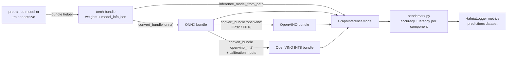

# package-openvino: Generic Model Export and Inference

Status: implemented. Designed and reviewed on 2026-11-18, and redesigned on 2026-11-20 as a graph of
components (section 3). See [section 11](#11-decisions) for the decisions.
Scope: the `package-openvino` trainer package, built locally next to `../hafnia`,
`../trainer-object-detection` and `../trainer-classification`.

---

## 1. What we are trying to do

Today each trainer package (RF-DETR detection, ResNet classification) owns its own model
wrapper, its own zip format and its own export/benchmark scripts. Nothing outside a trainer
package knows how to open or run its model archive.

The goal is to turn that around:

1. **A user uploads a model** (from a supported framework and file format) together with a
   description of the model.
2. **We can convert it** to OpenVINO IR, optionally quantized to INT8.
3. **We can run it** with OpenVINO (and ONNX Runtime, and later TensorRT) through **one
   common interface** that always returns Hafnia primitives (`Bbox`, `Bitmask`,
   `Classification`, ...).
4. Because the output is always Hafnia primitives, **everything downstream is shared**:
   visualization, benchmarking (latency + accuracy), and serving.

Two things have to be standardized to make this work:

- **The inference interface**: an `InferenceModel` base class with a fixed set of methods.
- **The storage format**: a model bundle (one zip) holding the serialized model plus a
  machine-readable description, "model info", that says how to run it and what it returns.

For this first iteration everything lives in one trainer package, `package-openvino`. It does
**no training**. Its scripts are generic: they work on any model bundle whose components are
installed, not on one specific architecture.

---

## 2. Where we start from (what already exists)

| Thing | Where | Notes |
|---|---|---|
| `InferenceModel` ABC | `hafnia/src/hafnia/dataset/benchmark/inference_model.py` | `predict(image, sample_dict) -> List[Primitive]`, `predict_batch(...)` (default loops over `predict`), `get_model_info() -> ModelInfo`. No load/save, no raw predict. |
| `ModelInfo` | `hafnia/src/hafnia/dataset/hafnia_dataset_types.py:547` | Subclass of `TasksInfo`: `tasks`, `name`, `version`, `description`, reference URLs, free-form `meta`. Nothing about format, engine, files, pre/post-processing. |
| `TaskInfo` / `ClassInfo` | same file, `:91` | Primitive type + ordered list of unique class names + task name. Serializes the primitive as a string, which works well for JSON. |
| Benchmark | `hafnia/src/hafnia/dataset/benchmark/benchmark.py` | `run_inference_on_dataset` / `run_benchmark` work on any `InferenceModel` and compute accuracy metrics (mAP etc.). **They don't measure latency.** |
| RF-DETR wrapper | `trainer-object-detection/src/trainer_object_detection/wrapped_model.py` | Zip = `model_config.json` + weights. Config is RF-DETR specific (`InitModelConfig`). |
| ResNet wrapper | `trainer-classification/src/trainer_classification/wrapped_model.py` | Same zip pattern, own `ModelConfig`. |
| OpenVINO export | `trainer-object-detection/scripts/export_openvino.py` | RF-DETR → temporary ONNX → `ov.convert_model` → optional NNCF INT8 PTQ (calibrated on a Hafnia dataset) → writes OpenVINO Model API `rt_info` (mean/scale, resize type, labels) for DLStreamer. |
| Benchmark script | `trainer-object-detection/scripts/benchmark.py` | Loads dataset (hidden dataset on platform, sample locally), picks up checkpoint from `MDI_CHECKPOINT_DIR`, optional class mapping, logs metrics through `HafniaLogger`. |
| Platform conventions | `HafniaLogger`, `hafnia.utils` | Input model = `*.zip` in `logger.path_model_checkpoints()`; output = `logger.path_model()`; dataset via `get_dataset_path_in_hafnia_cloud()` when `HAFNIA_CLOUD=true`. |

Takeaways:

- The **zip with a JSON description** is already the de-facto pattern in both trainers. We
  generalize it rather than invent something new.
- The existing OpenVINO exporter already writes pre-processing metadata into the IR. That
  is the same idea as "model info", but stored in OpenVINO-specific form. We should produce
  that `rt_info` as a by-product of our own model info, so Intel tooling (Model API,
  DLStreamer, OVMS) keeps working.
- The quantization code is mostly generic already. The only RF-DETR specific part is the
  calibration preprocessing. Once preprocessing is described in model info, calibration
  becomes generic too.

---

## 3. Core concepts

> **Redesigned on 2026-11-20: a model is a graph of components.** Until then a model was run by a
> *flavor*, one class per (engine, framework, decoder), with fixed preprocess / predict / postprocess
> stages. Four model families on two engines needed eight flavor classes, and every new family would
> add one per engine. Section 11 lists the decisions, "The flavor design" at the end what it was.

### 3.1 Model bundle (storage format)

A model bundle is a **single zip file** (so it fits the existing "checkpoint is a zip" platform
convention) or the same content as a directory:

```
ssdlite320_openvino_int8.zip
├── model_info.json        # always present, always this name
└── network/               # files of the component named 'network'
    ├── model.xml
    └── model.bin
```

Rules:

- `model_info.json` at the root describes everything else. Paths inside it are relative to the
  bundle root, and each component keeps its files in a folder with its name.
- A bundle holds exactly the files its model info lists.
- Loaders accept **either the zip or an already extracted directory**. This avoids temp-dir
  handling in serving and allows fast local iteration.
- **Loading a bundle never runs code from it.** Processing steps are named component types whose
  code lives in the installed packages. Weights are read as data (`torch.load(weights_only=True)`).

### 3.2 Model info: tasks and a graph

Model info answers two questions:

1. **What is it?** Name, framework, variant, tasks/classes. This doesn't change when the model is
   converted.
2. **How do I get from an image to primitives?** The `graph`: an ordered list of components.

All inputs, outputs and intermediate values of a model are items of **one data dictionary**. A
component names the keys it reads and the keys it writes. The graph names the keys the caller
provides (`inputs`, e.g. `image`) and gets back (`outputs`, e.g. `predictions`).

```
image ─▶ load_image ─▶ resize ─▶ to_tensor ─▶ network ─▶ nms ─▶ to_bboxes ─▶ predictions
          (numpy)      (numpy)    (numpy)     (onnx)   (numpy)   (numpy)
                          └──────────── image_transform ───────────┘
```

A component has:

| Field | Meaning |
|---|---|
| `name` | Unique in the graph, also the folder of its files |
| `type` | What it does: `resize_image`, `network`, `anchor_nms`, ... |
| `runtime` | How it is expressed: `numpy`, `torch`, `onnx`, `openvino` |
| `inputs`, `outputs` | Port (argument or tensor name) → data dictionary key |
| `params` | Typed parameters of the component type |
| `files` | Its files in the bundle |
| `batched` | Called once per batch (inputs stacked on a new first axis) or once per sample |
| `conversions` | Target → `{supported, reason, options}`: what it can be converted to, and how |
| `provenance` | Where it came from: parent component, tool versions, quantization settings |

Ports are mapped to keys so one component type can be used twice in a graph, and so a network's
tensor names don't have to be the names the rest of the graph uses.

The graph is validated when the model info is read: unique component names and files, every key
a component reads comes from a graph input or an earlier component, and every key is written
exactly once.

### 3.3 Components

A component **implementation** is a class for one (type, runtime, engine):

| Type | Runtime | Engine | Where |
|---|---|---|---|
| `load_image`, `resize_image`, `image_to_tensor` | numpy | numpy | `inference_model_core/components/image.py` |
| `anchor_nms`, `query_topk`, `detections_to_bboxes` | numpy | numpy | `inference_model_core/components/detection.py` |
| `classification_from_logits` | numpy | numpy | `inference_model_core/components/classification.py` |
| `network` | onnx | onnxruntime | `inference_model_onnxruntime/components.py` |
| `network` | onnx, openvino | openvino | `inference_model_openvino/components.py` |
| `torchvision_ssd_network`, `torchvision_faster_rcnn` | torch | torch | `model_exporters/torchvision_detection.py` |
| `torchvision_classifier` | torch | torch | `model_exporters/torchvision_classification.py` |
| `rfdetr_network` | torch | torch | `model_exporters/rfdetr_detection.py` |

- **Runtime and engine are separate on purpose.** The runtime says how a component is stored, the
  engine what executes it. An ONNX network runs on ONNX Runtime by default and on OpenVINO when
  asked.
- **Networks are generic.** A `network` is a tensor graph in model files whose ports are its
  tensor names. The engines know nothing about model families: adding a family needs no engine
  code.
- **Processing components are thin wrappers** with typed parameters around plain NumPy functions
  (`preprocessing.py`, `detection.py`, `classification.py`, `primitives.py`), which are tested on
  their own. They don't depend on torch: an OpenVINO serving image shouldn't need PyTorch.
- **Torch networks are stored by reference**: the weights plus the parameters that name the code
  building the module (e.g. `architecture: ssdlite320_mobilenet_v3_large`). They are the source
  format of a model. Loading one needs torch and the model's library; the ONNX and OpenVINO
  versions are self-contained.

Registry: implementations register with the `@register_component` class decorator. Packages list
theirs in the entry point group `hafnia.inference_model_components`, named
`<type>/<runtime>/<engine>`, and are **imported only when a graph needs them**. Loading an ONNX
bundle never imports torch, and a separately installed package adds components without a central
list to edit.

Standard components and the data they pass on:

| Type | Inputs → outputs | Parameters |
|---|---|---|
| `load_image` | image (path, PIL, array) → image (H, W, 3 uint8 RGB) | |
| `resize_image` | image → image, transform | mode (stretch, letterbox, keep_ratio_pad), height, width, interpolation, antialias, pad_value |
| `image_to_tensor` | image → tensor (no batch axis) | color_order, scale, mean, std, layout, dtype |
| `anchor_nms` | boxes (A, 4), scores (A, C) → boxes, scores, labels | score_threshold, nms_iou_threshold, topk_candidates, max_detections, background_index |
| `query_topk` | boxes (Q, 4) cxcywh, logits (Q, C), transform → boxes, scores, labels | num_select |
| `detections_to_bboxes` | boxes, scores, labels, transform *or* image → predictions | task_name, score_threshold |
| `classification_from_logits` | logits (C,) → predictions | task_name, score_threshold |

`transform` (`ImageTransform`) says how the original image maps to the network input (scale and
padding), so boxes can be mapped back to normalized coordinates on the original image, which is
what Hafnia primitives use. A network that resizes itself returns boxes in image pixels:
`detections_to_bboxes` then takes the `image` instead of a `transform`.

Rule of thumb, unchanged: **model info holds configuration, the installed packages hold code.**

### 3.4 Execution

`ModelGraph` loads the components of a bundle and runs them in order on the data dictionary.

- **Values are kept per sample, without a batch axis.** A `batched` component gets the values of
  all samples stacked on a new first axis, and its outputs are split again. Any other component is
  called once per sample. So `resize` and `nms` are written for one image, an SSD network gets
  `[N, 3, 320, 320]`, and Faster R-CNN (`[3, H, W]` in, a variable number of boxes out) is simply
  not batched. There is no special case for it.
- A network with a static batch axis takes batches of that size: the graph feeds it in chunks
  (`max_batch_size`).
- **Components of different runtimes run in one graph** and exchange NumPy arrays. A torch
  network between NumPy components is the normal case for a source bundle.
- `run(inputs, outputs=[...])` returns intermediate values and only runs the components needed for
  them. Calibration and the comparison of network outputs use this.
- `run_batch(..., timings=...)` collects the time spent per component, which is the latency
  report.
- The executor itself costs little: 0.06 ms per call between the components of an SSD graph. Run
  back to back on the same SSD network, `predict` took 12.3–16.2 ms with the flavor design and
  12.6–12.7 ms with the graph (ONNX Runtime, dev laptop), a difference within the noise of the
  machine.

### 3.5 Loading: `inference_model_from_path()`

```python
model = inference_model_from_path("ssdlite320_onnx.zip")  # default engines
model = inference_model_from_path("ssdlite320_onnx.zip", inference_engine="openvino")  # ONNX network on OpenVINO
model = inference_model_from_path("ssdlite320_onnx.zip", params={"score_threshold": 0.5}, device="CPU")
primitives = model.predict(image)
```

There is **one** inference model class for all bundles, `GraphInferenceModel`. It feeds the image
as graph input `image` and returns the graph output `predictions`.

Load-time settings, none of them stored in the bundle:

- **`inference_engine`**: every component with an implementation on that engine runs on it, the
  others on their default engine. It is an error if no component can.
- **`params`**: overrides of component parameters. `{"score_threshold": 0.5}` applies to every
  component that has the parameter, `{"nms.score_threshold": 0.5}` to one. They are validated by
  the component's typed parameter model, and an unknown name is an error.
- **`device`, `num_threads`** for all engines, and **`engine_options`** per engine, e.g.
  `{"openvino": {"performance_hint": "LATENCY"}}`.

### 3.6 Conversion

A bundle is converted **component by component** with one generic function:

```python
convert_bundle(path_source, path_bundle, target="onnx")
convert_bundle(path_source, path_bundle, target="openvino", options={"precision": "fp16"})
convert_bundle(path_source, path_bundle, target="openvino_int8", calibration_inputs=[{"image": path}, ...])
```

- Every component that lists the target in its `conversions` is converted. All others are copied
  unchanged, so NumPy processing stays next to a converted network.
- **The bundle says what is possible and how.** `conversions` holds the component's export
  options per target: the ONNX opset and whether the batch axis is dynamic, or the graph nodes to
  keep in floating point when quantizing. `supported: false` with a `reason` marks a component that
  can't be converted, e.g. to INT8. Options passed to `convert_bundle` override the stored ones.
- **Converters** turn components of one runtime into a target. They register with
  `@register_converter` and through the entry point group `hafnia.inference_model_converters`
  (`<source runtime>/<target>`):

  | Converter | Where |
  |---|---|
  | torch → `onnx` | `inference_model_torch/convert.py`, calling the torch component's `export_onnx` |
  | onnx → `openvino` (FP32 or FP16) | `inference_model_openvino/convert.py` |
  | onnx, openvino → `openvino_int8` | `inference_model_openvino/convert.py` (NNCF) |

- **Chains are found automatically**: a torch bundle converts to `openvino_int8` through
  torch → onnx → openvino_int8, as long as the component lists every step.
- **Calibration is generic.** For targets that calibrate, the caller passes graph inputs of
  representative samples. Each converted component gets what it gets at inference: the samples are
  run through the source graph up to that component. No model specific calibration code exists.
- A converted component keeps the conversions that still apply (an ONNX network keeps `openvino`
  and `openvino_int8`, an FP32 IR network `openvino_int8`, an INT8 network none) and records its
  parent in `provenance`.

---

## 4. Interfaces

All in `src/inference_model_core`.

```python
class Component(ABC):                       # component.py
    type: ClassVar[str]; runtime: ClassVar[str]; engine: ClassVar[str]
    params_model: ClassVar[Type[BaseModel]]             # typed parameters
    input_ports, optional_input_ports, output_ports     # checked against the component info

    @classmethod
    def load(cls, info, model_info, path_dir, options) -> Self: ...   # read files of the bundle
    def files(self) -> Dict[str, FileSource]: ...                     # for writing the bundle
    def run(self, inputs: Dict[str, Any]) -> Dict[str, Any]: ...      # port -> value
    @classmethod
    def create_info(cls, name, inputs, outputs, params=None, ...) -> ComponentInfo: ...

class ModelGraph:                           # graph.py
    @classmethod
    def load(cls, path_bundle, inference_engine=None, params=None, device="CPU", num_threads=None,
             engine_options=None, outputs=None) -> ModelGraph: ...
    def write(self, path_bundle, overwrite=False) -> Path: ...
    def run(self, inputs, outputs=None) -> Dict[str, Any]: ...                        # one sample
    def run_batch(self, inputs, outputs=None, timings=None) -> Dict[str, List[Any]]: ...

class GraphInferenceModel(hafnia.InferenceModel):   # inference_model.py
    def predict(self, image, sample_dict=None) -> List[Primitive]: ...
    def predict_batch(self, images, sample_dicts=None) -> List[List[Primitive]]: ...
    def get_model_info(self) -> ModelBundleInfo: ...
    def write_model(self, path_bundle, overwrite=False) -> Path: ...

def convert_bundle(path_source_bundle, path_bundle, target, options=None, calibration_inputs=None,
                   provenance=None, overwrite=False) -> Path: ...                     # convert.py
Converter = Callable[[ConversionRequest], ComponentInfo]
```

- `GraphInferenceModel` **extends** Hafnia's `InferenceModel`, so `hafnia.dataset.benchmark` works
  unchanged. `get_model_info()` returns a `ModelInfo` (with `tasks`), as Hafnia expects.
- `ModelGraph` is the general interface: any inputs and outputs. `GraphInferenceModel` requires
  the input `image` and an output `predictions`.
- `NetworkComponent` (`network.py`) is the base class of file-based networks: it checks the ports
  against the tensors, keeps the files for writing, and compares the model info with the stored
  graph at load time. `TorchNetworkComponent` (`inference_model_torch/component.py`) is the base
  class of torch networks: device handling, NumPy ↔ tensors, and the `export_onnx` hook.
- A converter gets a `ConversionRequest` (the component, its files, the merged options, a
  calibration feed) and returns the component info of the converted component, with the same name
  and data keys.

"Native" tensors: components exchange **NumPy arrays**. ONNX Runtime and OpenVINO accept them
directly, torch components convert at their boundary. Zero-copy device buffers (TensorRT, torch
components next to each other on a GPU) are a later optimisation.

---

## 5. Model info schema

Implemented as `ModelBundleInfo(ModelInfo)` in `src/inference_model_core/model_info.py`, format
version `2.0.0`. A bundle of another major version is rejected with a message to create it again.

```python
class ConversionInfo(BaseModel):
    supported: bool = True
    reason: Optional[str] = None  # why it is not supported
    options: Dict[str, Any] = {}  # export options of this component for the target


class ComponentInfo(BaseModel):
    name: str  # lower case identifier
    type: str
    runtime: str
    inputs: Dict[str, str]  # port -> data key
    outputs: Dict[str, str]
    params: Dict[str, Any] = {}
    files: List[str] = []
    batched: bool = False
    conversions: Dict[str, ConversionInfo] = {}
    provenance: Optional[Dict[str, Any]] = None


class GraphInfo(BaseModel):
    inputs: List[str]  # e.g. ["image"]
    outputs: List[str]  # e.g. ["predictions"]
    components: List[ComponentInfo]  # in execution order


class ModelBundleInfo(ModelInfo):  # hafnia's name, tasks, version, description, ...
    format_version: str = "2.0.0"
    framework: str  # where the model comes from: 'torchvision', 'rfdetr'
    variant: Optional[str] = None
    graph: GraphInfo


class NetworkParams(BaseModel):  # 'params' of 'network' components
    precision: Literal["fp32", "fp16", "int8"] = "fp32"
    input_tensors: List[TensorInfo]  # name, shape (None = dynamic), dtype
    output_tensors: List[TensorInfo]
```

The network component of an SSDLite320 ONNX bundle:

```json
{
    "name": "network", "type": "network", "runtime": "onnx", "batched": true,
    "inputs": {"images": "input_tensor"},
    "outputs": {"boxes": "anchor_boxes", "scores": "anchor_scores"},
    "files": ["network/model.onnx"],
    "params": {
        "precision": "fp32",
        "input_tensors": [{"name": "images", "shape": [null, 3, 320, 320], "dtype": "float32"}],
        "output_tensors": [{"name": "boxes", "shape": [null, 3234, 4], "dtype": "float32"},
                           {"name": "scores", "shape": [null, 3234, 91], "dtype": "float32"}]
    },
    "conversions": {
        "openvino": {"supported": true, "reason": null, "options": {}},
        "openvino_int8": {"supported": true, "reason": null,
                          "options": {"ignored_node_patterns": ["/(?!backbone/|head/).*"]}}
    }
}
```

`framework` and `variant` are informational: nothing dispatches on them any more.

### TaskInfo

`TaskInfo` works as it is, with **one task class per model label** (decided on 2026-11-19).
`TaskInfo` requires unique class names, and the position in `classes` is the class index. Real
models' labels don't line up with that: torchvision COCO models emit 91 labels including
`__background__` and repeated `"N/A"` placeholders, RF-DETR emits `num_classes + 1` with "no
object" last.

The bundle helpers put every model label in the task, with unique placeholder names for labels
without a class: `NotDefined_000`, `NotDefined_012`, ..., the convention of
trainer-object-detection's archives (`model_exporters/class_names.py`). Label = class index, so no
mapping is needed at inference. COCO models (SSD, Faster R-CNN, RF-DETR) carry the same 91-class
task, and trainer archives pass through unchanged. `detections_to_bboxes` only drops labels beyond
the task's classes (`task_label_mask`, for RF-DETR's "no object" column).

The cost is in evaluation: Hafnia's metrics require the prediction task's class names to equal the
ground truth's, in order. `package_openvino/metrics.py` aligns the predictions to the dataset's
classes by name before computing metrics (`align_prediction_classes`, and a `run_benchmark`
wrapper), removing predictions of other classes. It raises when the dataset has classes the model
doesn't, since then the label spaces differ and a class mapping is needed. A cleaner long-term fix
is upstream in hafnia: let the metrics ignore prediction classes the ground truth doesn't have.

### Where should the change live?

The extension lives in this package first (`ModelBundleInfo(ModelInfo)` in the core module) and
goes upstream to `../hafnia` once it has settled. That avoids a Hafnia release for every schema
iteration (Q5).

---

## 6. Package layout

The brief asks for concepts to be separated now so they can move to their own repos later.
The cleanest way: **several top-level Python packages inside one distribution.** When a
module later moves to its own repo, import paths stay the same.

```
package-openvino/
├── pyproject.toml            # hatch: packages = [all src/* below]; entry points for components and converters
├── Dockerfile                # same pattern as trainer-object-detection
├── .hafniaignore  .python-version  README.md
├── docs/design.md            # this document (+ design_review.md, a review of the flavor design)
├── src/
│   ├── inference_model_core/        # → later: hafnia
│   │   ├── model_info.py            #   ModelBundleInfo, GraphInfo, ComponentInfo, ConversionInfo
│   │   ├── bundle.py                #   read/write zip|dir, model_info.json I/O
│   │   ├── component.py             #   Component base class, registry, load options
│   │   ├── network.py               #   NetworkComponent: base class of file-based networks
│   │   ├── graph.py                 #   ModelGraph: load, write, run, run_batch
│   │   ├── inference_model.py       #   GraphInferenceModel, inference_model_from_path
│   │   ├── convert.py               #   convert_bundle, converter registry
│   │   ├── components/              #   standard NumPy components (image, detection, classification)
│   │   ├── preprocessing.py         #   functions: load, resize, image to tensor, ImageTransform
│   │   ├── detection.py             #   functions: NMS, per-class selection, query top-k
│   │   ├── classification.py        #   functions: softmax, top-1
│   │   └── primitives.py            #   functions: pixel boxes -> normalized Hafnia primitives
│   ├── inference_model_onnxruntime/ # → later: inference-model-onnx-runtime repo
│   │   └── components.py            #   'network' on (onnx, onnxruntime)
│   ├── inference_model_openvino/    # → later: inference-model-openvino repo
│   │   ├── components.py            #   'network' on (onnx, openvino) and (openvino, openvino)
│   │   └── convert.py               #   converters to OpenVINO IR: FP32, FP16, INT8 (NNCF)
│   ├── inference_model_torch/       # torch runtime
│   │   ├── component.py             #   TorchNetworkComponent: base class of torch networks
│   │   ├── convert.py               #   converter torch -> ONNX
│   │   └── onnx_export.py           #   shared ONNX export settings
│   ├── model_exporters/             # model families: torch components and bundle helpers
│   │   ├── registry.py              #   pretrained name or trainer archive → bundle helper
│   │   ├── trainer_archive.py       #   trainer model archives (model_config.json + weights)
│   │   ├── class_names.py           #   one task class per model label, placeholder names
│   │   ├── torchvision_detection.py
│   │   ├── torchvision_classification.py
│   │   └── rfdetr_detection.py
│   └── package_openvino/            # glue that stays in the trainer: benchmarking, platform helpers
│       ├── class_mapping.py         #   class mappings as data (JSON file or inline JSON)
│       ├── latency.py               #   latency per component
│       ├── metrics.py               #   Hafnia's benchmark with prediction classes aligned by name
│       └── platform.py              #   checkpoint discovery, dataset loading
├── scripts/
│   ├── export_to_onnx.py            # any supported model: trainer archive or pretrained name
│   ├── export_onnx_to_openvino.py
│   └── benchmark.py
├── examples/
│   ├── example_inference_model.py   # basic flow: bundle, ONNX, run, convert, run on OpenVINO, draw, benchmark
│   └── example_compare_models.py    # models x networks/engines: mAP + latency table
└── tests/                       # one folder per module under src/, shared helpers at the root
    ├── conftest.py                  # session fixtures: micro dataset, torch, ONNX and OpenVINO bundles
    ├── helpers.py                   # dummy network component, detection matching
    ├── micro_datasets.py            # creates tests/data/micro-* from the Hafnia platform (8 COCO images)
    ├── data/micro-coco-2017/
    ├── inference_model_core/        # test_model_info, test_graph, test_components, test_convert, ...
    ├── inference_model_onnxruntime/ # test_onnxruntime_components
    ├── inference_model_openvino/    # test_openvino_components (parity with ONNX Runtime), test_openvino_convert
    ├── model_exporters/             # parity with the original torch models, per family
    ├── package_openvino/            # test_latency, test_metrics, test_platform, test_class_mapping
    └── scripts/                     # test_benchmark_script
```

Test file names are unique across folders: the folders have no `__init__.py` (a
`tests/inference_model_core` package would shadow the real one), so pytest imports test files by
their base name.

Dependency rules:

- `inference_model_core` imports **no** engine and **no** torch.
- Engine packages import `inference_model_core`, never each other.
  `inference_model_openvino.convert` reads ONNX with OpenVINO itself, not through ONNX Runtime.
- torch is imported only by `inference_model_torch` and `model_exporters`, and those only when a
  bundle with a torch component is loaded or created.
- Optional dependency groups (`onnxruntime`, `openvino`, `torch`, `rfdetr`) keep each split honest
  inside one repo.

---

## 7. End-to-end flow



Only the network component changes along the way. `scripts/export_to_onnx.py` does the first two
arrows, `scripts/export_onnx_to_openvino.py` the conversions to OpenVINO.

The ONNX Runtime path is the **reference**. Comparing ORT vs OpenVINO FP32 vs OpenVINO INT8 on the
same dataset is the main way to confirm that conversion and quantization didn't break the model.

---

## 8. Model families and scripts

All scripts follow the trainer conventions: `cyclopts` CLI, `HafniaLogger`, input bundle taken
from the checkpoint dir when present (otherwise a `--model-path`), output written to
`logger.path_model()`, `auto_save_command_builder_schema` for the `*.schema.json` files.

### 8.1 Model families (`model_exporters`)

Each family module has the torch component of its network and functions that write a bundle with
that network: `create_torchvision_detection_bundle`, `create_torchvision_classification_bundle`,
`create_rfdetr_detection_bundle`, plus `create_pretrained_bundle(name)` and
`create_bundle_from_trainer_archive(path)` in `registry.py`, which pick the family (importing it
only then, so torchvision models don't need `rfdetr`).

| | SSDLite320 | Faster R-CNN 320 | ResNet18 | RF-DETR (Nano to Large) |
|---|---|---|---|---|
| Sources | pretrained | pretrained | pretrained, trainer-classification archive | pretrained, trainer-object-detection archive |
| Graph | load_image → resize → to_tensor → network → nms → to_bboxes | load_image → to_tensor → network → to_bboxes | load_image → resize → to_tensor → network → to_classification | load_image → resize → to_tensor → network → topk → to_bboxes |
| Network | `images [N, 3, 320, 320]` → `boxes [N, 3234, 4]`, `scores [N, 3234, 91]` | `image [3, H, W]` → `boxes [n, 4]`, `scores [n]`, `labels [n]` | `images [N, 3, S, S]` → `logits [N, C]` | `input [N, 3, R, R]` → `dets [N, 300, 4]`, `labels [N, 300, C+1]` |
| In the network | backbone, head, anchor box decoding, clipping, softmax | everything incl. resize, normalize, NMS | the model | RF-DETR's own ONNX export |
| After the network | `anchor_nms`: per-class threshold, top-k, NMS | score threshold | softmax, top-1 | `query_topk`: sigmoid, top-300 over (query, class). No NMS |
| Resize | stretch, linear | in the network (aspect ratio kept) | stretch, antialiased | stretch, antialiased |
| Batched | yes | no | yes | yes |
| Default score threshold | 0.001 (torchvision's) | 0.05, network keeps ≥ 0.001 | 0 | 0.05 (trainer-object-detection's) |
| INT8 options | float outside `/backbone`, `/head` | float outside backbone, RPN head, box head | none | `model_type: transformer` |

- **Network only where possible** (design review, point 1). SSD is single-stage, so resize,
  normalize and NMS are components. The score threshold is then a runtime setting and the network
  batches and quantizes. Faster R-CNN is two-stage with NMS on proposals inside the network and
  stays the full model, a stress test of the generic parts.
- **Torch networks are rebuilt by reference.** The bundle stores `model.state_dict()` and the
  architecture name. torchvision builds detectors with frozen batch norm only when they start
  from pretrained weights, so the rebuild freezes batch norm when the stored weights have no
  `num_batches_tracked`. Weights load with `strict=True`.
- **RF-DETR checkpoints**: RF-DETR unpickles its checkpoints and they carry the optimizer state
  (366 MB for Nano). The bundle gets a copy with the weights and the plain settings only (122 MB),
  which reads with `weights_only=True`. The component checks that before RF-DETR loads it.
- **Trainer archives** (`trainer_archive.py`): a zip with `model_config.json` (model name, task,
  settings) and the weights it names. Platform checkpoints of both trainers use this format.
- **`rfdetr` dependency**: optional extra `rfdetr` (`rfdetr==1.8.1`, same torch 2.10.0).
- **ONNX export**: the TorchScript-based exporter (`dynamo=False`, opset 17), called by each torch
  component's `export_onnx` with the component's `onnx` options (`opset_version`, and
  `dynamic_batch` for the batched networks).
- **Antialiased resize** (`resize_image.antialias`): both trainers resize with torchvision on
  tensors, which antialiases when downscaling. OpenCV's linear resize differed by 2–4 gray levels
  on average; PIL's bilinear resize matches torchvision within 0.25.
- Not supported yet: RF-DETR segmentation (`RFDETRSegNano`, masks) and keypoints.

**Parity with the original models** (micro COCO, 8 images, detections matched by IoU and class):

- The redesign changed no numbers: the ONNX networks, their inputs and the predictions are
  bit-identical to the flavor design's on all four families.
- Torch bundles against the original models: SSD and Faster R-CNN IoU ≥ 0.999 and scores within
  1e-4, ResNet18 probabilities within 1e-5, RF-DETR scores within 2e-6 on the same device (1e-3
  between CPU and CUDA).
- SSD on ONNX Runtime, image already 320 × 320: worst IoU 1.0000, worst score difference 1.2e-6.
  On original image sizes (OpenCV resize vs torch resize): worst IoU 0.9925, score difference
  0.008.
- Faster R-CNN: the same detections on ONNX Runtime and OpenVINO, worst score difference 1.8e-5,
  no extra detections. Also checked at five input sizes.
- ResNet18: same top-1 class on all images; probabilities within 1e-4 at the input size, within
  0.012 on original sizes (uint8 vs float resize).
- RF-DETR Nano: a few low-score boxes move (IoU down to 0.97 below score 0.2), boxes from score
  0.2 match at IoU ≥ 0.9965. A trainer archive with the pretrained weights gives the same
  detections as the pretrained model. mAP 0.660, mAP@50 0.793 on all engines.
- OpenVINO vs ONNX Runtime: SSD network outputs within 1e-2 px and 1e-4 on scores, ResNet18
  probabilities within 1e-4. RF-DETR differs in low-score queries (boxes moved by up to 0.4 of the
  image); detections from score 0.1 match at IoU ≥ 0.99, scores within 0.01.

**Resize inside the network, Faster R-CNN.** torchvision scales by `min(320 / shortest side, 640 /
longest side)` and floors `side × scale`. Eager torch computes that in double precision, the
traced graph in float32, where an exact result can drop just below the integer: 400 × 640 resized
to 319 × 511 instead of 320 × 512. The detections then shifted (IoU 0.988, scores off by up to
0.07). The ONNX export computes the size in int64 instead (`side × 320 // shortest`), which is
exact.

**Images without proposals, Faster R-CNN.** Blank, uniform and noise frames get no proposals from
the RPN, so the graph must run with zero boxes. torchvision handles that case in ways that don't
survive tracing. The ONNX export swaps in zero-box-safe replacements, with the same arithmetic:

- `BoxCoder.decode` reshapes with `-1` behind a Python `if box_sum > 0`. A reshape of zero boxes
  to `(0, -1, 4)` is ambiguous, so the graph crashed. The replacement stacks the coordinates to
  `(boxes, classes, 4)` and has no reshape.
- `clip_boxes_to_image` ends with `reshape(boxes.shape)`, which the exporter turns into the same
  kind of ambiguous reshape. ONNX Runtime only got past it through a graph optimisation.
- `batched_nms` returns `torch.empty((0,))` for zero boxes, an empty constant inside an ONNX `If`.
  **OpenVINO reads empty constants as scalars**, so it returned one row of uninitialized memory
  (random box, score and label) instead of nothing. Worth reporting to Intel.

With these, torch, ONNX Runtime and OpenVINO return nothing on blank and noise images and the same
detections on the test images, in both directions.

**Found in trainer-classification** (not changed here): `InferenceModelResNet18.predict` puts a
numpy image through `v2.Resize`, which leaves numpy arrays unchanged, so inference runs at the
original image size, not `image_size`. Training only resizes with `--resize`, while the archive
stores `image_size` (224 by default) either way. Our bundle follows the archive's `image_size`,
which matches training only when training resized.

### 8.2 `scripts/export_to_onnx.py`

- Input: a checkpoint or `--model-path` trainer archive, otherwise a pretrained `--model-name`.
- Writes the bundle with the torch network to a temporary folder (the bundle helper), converts it
  with `convert_bundle(target="onnx", options={"opset_version": ...})` and writes the ONNX bundle
  to the experiment model folder. The bundle is loaded once to fail here, not downstream.

### 8.3 `scripts/export_onnx_to_openvino.py`

- Input bundle from the checkpoint dir when present, otherwise `--model-path`.
  `--precision fp32|fp16|int8` (default fp32), `--device` for the verification run.
- `fp32` / `fp16`: `convert_bundle(target="openvino", options={"precision": ...})`. Weights are
  compressed to FP16 only when asked (design review 4.2). SSDLite320: `model.bin` is 13.8 MB in
  FP32 and 6.9 MB in FP16.
- After conversion, the source and the converted bundle both run on OpenVINO with the same image,
  and the largest difference of the converted network's outputs is logged. SSDLite320: 0 in FP32.
  In FP16, 0.16 px on boxes and 1e-3 on scores.
- Not done yet: static-shape reshape (needed for NPU) and Model API `rt_info`.

**INT8** (`--precision int8`): `convert_bundle(target="openvino_int8", calibration_inputs=...)`,
NNCF post-training quantization of an FP32 ONNX or IR network.

- Calibration data as in the trainers: the experiment's dataset on the platform, locally
  `--calibration-dataset name:version` (default `coco-2017:1.0.0`) or a dataset folder.
  `--calibration-split-name` (default `validation`, or `all`), `--calibration-samples` (default
  300, a warning below that).
- **Nodes kept in floating point.** NNCF's default quantized the SSD box decoding and softmax as
  well. Pixel coordinates and scores in 8 bit dropped mAP from 0.348 to 0.152 on the micro dataset,
  and the noisy scores let so many boxes through that NMS made `predict` 30× slower (450 ms).
  Which graph parts must stay in float depends on the graph, so the code that builds the network
  stores them as the `openvino_int8` option `ignored_node_patterns` (ONNX node name regexes), and
  the converter only reads them. A test checks that every pattern still matches a node, so a
  renamed graph doesn't silently lose the protection.
- **RF-DETR needs NNCF's transformer mode** (option `model_type: transformer`): the default
  dropped mAP from 0.66 to 0.0; transformer mode gives 0.668.
- Preset `mixed` by default (asymmetric activations, suited to MobileNetV3's hard-swish).
  `performance` is the alternative (`--quantization-preset`).
- Results, calibrated on the 8 micro images: SSDLite320 mAP 0.348 → 0.316 on those images. On 100
  `coco-2017` images, FP32 0.307 vs INT8 0.295–0.298. Faster R-CNN 0.282 → 0.275. ResNet18 keeps
  the top-1 class on 7 of 8 images. `model.bin`: SSDLite320 13.8 → 4.2 MB.
- **INT8 speed depends on the hardware.** The dev laptop (i7-10875H) has AVX2 but no VNNI/AMX:
  SSD and Faster R-CNN take the same time in INT8 as in FP32, ResNet18 is 2.5× faster, RF-DETR is
  slower (163 vs 108 ms). INT8 latency has to be measured on the target hardware.
- Not done yet: `nncf.quantize_with_accuracy_control`.

### 8.4 `scripts/benchmark.py`

- Any bundle from the checkpoint or `--model-path`, `--inference-engine` to run its components on
  another engine, `--device` passed to the engines. Dataset as in the other scripts; `--split-name`
  (default `test`, or `all`), `--samples`, `--batch-size`.
- **Accuracy**: Hafnia's `run_inference_on_dataset` + `metric_calculations`, with the bundle's
  default (low) score threshold. Prediction classes are aligned to the dataset's by name first
  (e.g. 91 COCO model classes to `coco-2017`'s 80). `--model-class-mapping` /
  `--dataset-class-mapping` take a JSON file or inline JSON object and are applied with
  `class_mapper(method="remove_undefined")`. Splits without ground truth only run inference. The
  predictions (annotations only) are written to the artifacts folder.
- **Latency**: `measure_latency` times **every component of the graph** per batch after `--warmup`
  untimed batches, on `--latency-samples` loaded images. Reports mean, p50, p90, p99 per component
  and in total in ms (`latency/network_p90_ms`, `latency/nms_mean_ms`, ...) and throughput in
  images/s. The latency run uses `--latency-score-threshold` (default 0.3), because the time of
  the components after the network depends on it.
- Everything is logged through `HafniaLogger`: configuration (model, the implementation of each
  component, engine versions, device, precision, dataset, split, batch size, settings) and
  metrics, plus a summary table.
- **Latency note (SSD, CPU, ONNX Runtime).** About 3.5 ms for resize and tensor conversion and
  11 ms for the network. NMS takes 86 ms at the torchvision default threshold of 0.001 (about 27k
  candidates), 4.5 ms at 0.05 and 2.7 ms at 0.3. Benchmarks must state the threshold. Accuracy
  runs use a low one, latency runs a serving one.
- Not done yet: throughput mode (OpenVINO async infer requests), `--task-name` for datasets with
  several tasks of the model's primitive.

---

## 9. Implementation order

1. ✅ **Scaffold** `package-openvino` (pyproject, Dockerfile, `.hafniaignore`, `uv`), copied from
   the trainer-object-detection conventions.
2. ✅ **Core**: model info schema, bundle I/O, base class, registry, `inference_model_from_path`.
3. ✅ **torchvision → ONNX** (SSDLite320 network only, Faster R-CNN MobileNetV3 320 full model) on
   ONNX Runtime + `scripts/export_to_onnx.py`. Parity against the original torch models: see 8.1.
4. ✅ **OpenVINO** (loading both ONNX and IR bundles) + generic ONNX → OpenVINO conversion. See 8.3.
5. ✅ **Quantization** (NNCF) with generic calibration. Test: mAP drop within a tolerance. See 8.3.
6. ✅ **Benchmark script** with latency + accuracy. See 8.4 (and
   `examples/example_compare_models.py` for the comparison).
7. 🔶 **Platform run**: `hafnia trainer create-zip`, `hafnia runc build-local`,
   `hafnia runc launch-local ...` for each script, then a real experiment. Local Docker run
   done (2026-11-19, with the flavor design), the platform experiment is not: see "Trainer
   package in Docker" below.
8. ✅ RF-DETR as a second family and ResNet18 classification (2026-11-19). See 8.1.
9. ✅ **Component graph redesign** (2026-11-20): models as graphs of components, torch as the
   source format, generic conversion. Steps 2 to 6 and 8 were moved to it with unchanged results
   (see "Parity" in 8.1).

---

### Trainer package in Docker (step 7)

Run on 2026-11-19 with the micro dataset mounted as the experiment dataset. **Not repeated after
the redesign of 2026-11-20**: the scripts kept their arguments, and were run locally since.

- `hafnia trainer create-zip .`: 817 KiB (scripts, `src/`, Dockerfile, lock file; tests, examples
  and data excluded by `.hafniaignore`).
- `hafnia runc build-local trainer.zip`: builds, image 13.8 GB (see the risks below). The image
  installs the project itself, which the component and converter entry points need.
- In the image, with `HAFNIA_CLOUD=true` and the platform folders mounted, all three scripts run
  in platform mode, each taking the previous output as its checkpoint:
  `export_to_onnx.py` (25 s, downloads the torchvision weights) →
  `export_onnx_to_openvino.py --precision int8 --calibration-split-name all` (22 s) →
  `benchmark.py --split-name all` (13 s: mAP 0.317, 86 images/s on the dev laptop CPU).
- `hafnia runc launch-local` itself could not be used on this machine:
  - It runs `docker run --runtime nvidia`, and the NVIDIA container runtime is not installed
    here. The package doesn't need a GPU.
  - It mounts only the dataset. A script that needs an input bundle (a checkpoint in
    `/opt/ml/checkpoints`) can't be tested with it, and outputs are lost with the container.
  - The README shows the equivalent `docker run` with the checkpoint and output folders
    mounted.
- Platform needs: internet access for the pretrained torchvision weights
  (download.pytorch.org), and a way to pass the output bundle of one experiment as the
  checkpoint of the next.

## 10. Risks and things to watch

- **Genericity is only proven by more model families.** Four families with different networks
  (single-stage, two-stage, transformer, classifier) now share all engine code. The next test is a
  family that needs a new component type, e.g. letterboxed YOLO or masks.
- **Rebuilding torch networks by reference.** The rebuilt module must match the stored weights
  exactly. Guards: `strict=True`, and a parity test against the original model per family. A new
  family needs both.
- **Torch bundles are not self-contained** and RF-DETR loads its checkpoints with pickle. The
  bundle's checkpoint copy holds tensors and plain values only, and the component rejects anything
  else. Bundles for serving should be ONNX or OpenVINO.
- **Preprocessing drift**: tiny differences (resize interpolation, PIL vs OpenCV, RGB/BGR)
  silently cost accuracy. Parity tests against the source framework are essential.
- **Dynamic shapes**: Faster R-CNN has dynamic H/W. NNCF and some OpenVINO devices (NPU) prefer or
  require static shapes. `dynamic_batch: false` gives a static batch axis for the batched
  networks; a static-shape reshape for OpenVINO is not done yet.
- **Docker image size**: torch + torchvision + openvino + nncf + onnxruntime in one image.
  Acceptable for a trainer package, but serving images must not need torch (which is why
  processing components are NumPy and components are imported only when used). Measured:
  **13.8 GB**, mostly the CUDA build of torch from PyPI and its NVIDIA libraries, which the package
  doesn't use. The CPU-only torch wheel would cut most of it. Decision (2026-11-19): keep the CUDA
  build for now, as in the other trainer packages.
- **Hardware for latency numbers**: latency only means something on the target device (Q7).
- **Untrusted uploads**: zip path traversal, file size limits, and no code or pickled objects in
  bundles.

---

## 11. Decisions

**Component graph redesign (2026-11-20):**

| Question | Decision |
|---|---|
| What is a model? | A **graph of components** that read and write one data dictionary. Replaces flavors (Q3, Q4). |
| How are processing steps stored? | **Named types with JSON parameters.** The code is in the installed packages, so loading a bundle never runs code from it. |
| What is the role of torch? | **The source format, stored by reference**: weights plus the name of the code that builds the module. A generic converter goes torch → ONNX → OpenVINO → INT8 with the export options stored per component. |
| Migration | **Replaced in place.** Bundle format 2.0.0; bundles of the flavor design have to be created again. |
| Processing inside the engine graph | **Later.** The design allows it: a conversion can merge components, e.g. `image_to_tensor` into the OpenVINO model. |

The open questions from the first draft were answered on 2026-11-18:

| # | Question | Decision |
|---|---|---|
| Q1 | How does a model get onto the platform? | **Checkpoint zip.** The bundle is a single zip placed in `MDI_CHECKPOINT_DIR`, the same mechanism the RF-DETR/ResNet trainers use. Locally, scripts take `--model-path`. |
| Q2 | Which ONNX models are accepted in v1? | **Our own bundle helpers only.** Bring-your-own ONNX with a hand-written `model_info.json` comes later; with the graph design it means listing existing components. |
| Q3 | What decides how a model is loaded? | ~~Dispatch on `(inference_engine, framework, postprocessing.decoder)`~~ Superseded: each component names its type and runtime. Size (nano/large/...) is the informational `variant` field. |
| Q4 | How are flavors built? | ~~Independent classes per engine~~ Superseded: there are no flavors. Engines only run `network` components. |
| Q5 | Where do the ModelInfo changes live? | **In package-openvino first.** Upstream to `../hafnia` once the schema has settled. |
| Q7 | Latency devices | **CPU by default**, with a `--device` flag passed through to the engines (`GPU`/`NPU`/`AUTO` where available). |
| Q8 | Video input | **Image only in v1** (video = frames one at a time). A graph can have other inputs than `image`; nothing uses that yet. |
| Q9 | End-to-end test models | **`ssdlite320_mobilenet_v3_large`** and **`fasterrcnn_mobilenet_v3_large_320_fpn`**, later ResNet18 and RF-DETR Nano. |

Assumptions not explicitly confirmed (defaults from the first draft):

- **Q6:** `get_model_info()` returns `ModelInfo` (which contains `tasks: List[TaskInfo]`), not
  a bare `List[TaskInfo]`, so Hafnia's existing benchmark keeps working.
- **Q10:** The missing second script is `scripts/export_to_onnx.py`.
- **Q11:** The ONNX export targets OpenVINO IR, not pt2. The reference classification trainer is
  `../trainer-classification`. "ModelInference" means `InferenceModel`.

Changes adopted from the [design review](design_review.md) of the flavor design (2026-11-18), and
what became of them:

| Review point | Decision | In the graph design |
|---|---|---|
| 1. Export contract | SSD models are **network only**; Faster R-CNN stays the **full model** | Unchanged (8.1) |
| 2. Engine binding | The bundle's engine is a default that the caller can override | Per component: `inference_engine=` |
| 3. Preprocessing | One implementation, also used for quantization calibration | Calibration runs the graph itself up to the component |
| 4.1 Settings | Typed decoder settings with load-time overrides; engine options separate | `params=` per component, `engine_options` |
| 4.2 Precision | FP16 compression only when asked, recorded in the model info | Unchanged (8.3) |
| 4.3 Open strings | Not applied | Applied: `type`, `runtime` and engine names are plain strings |
| 4.4 `framework` in the dispatch key | Not applied | Applied: nothing dispatches on `framework` |
| 4.5 `uint8` input | `scale` defaults to `None` for `uint8` tensors | Unchanged (`image_to_tensor`) |

Not applied, to decide separately: centre crop (4.5), file hashes (4.6), points to raise with
Intel (5.x), smaller code findings (6.x).

Still open:

- Does the Intel collaboration have target hardware or reference latency numbers (e.g. from
  OpenVINO `benchmark_app`) to compare against?

---

## The flavor design (until 2026-11-20)

For reference, what the redesign replaced (git history has the code, up to commit `e890172`):

- `model_info.json` had a `runtime` section: one model file, declarative `preprocessing`
  (resize, scale, mean/std, with steps marked as "in the graph"), a named `postprocessing.decoder`
  with parameters, and `quantization_hints`.
- A **flavor** was an `InferenceModelBase` subclass per (engine, framework, decoder), with a fixed
  `preprocess → predict_raw → postprocess` pipeline. Postprocessing was duplicated per engine
  and kept in line by cross-engine parity tests.
- Exporters wrote ONNX bundles directly; `export_onnx_bundle_to_openvino` and `quantize_bundle`
  converted them.

What didn't hold up: every model family needed a flavor class per engine, and the three fixed
stages with fixed signatures couldn't express a model that needs another order of steps or extra
data between them.
