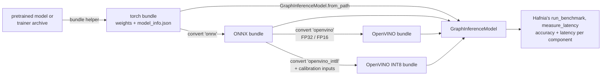

# hafnia-inference-model: Generic Model Export and Inference

Status: implemented. Designed and reviewed on 2026-11-18, redesigned on 2026-11-20 as a graph of
components, and on 2026-11-23 split into component definitions and a torch graph engine (section 2).
Since 2026-11-24 the user interface is the `ModelBundle` and `GraphInferenceModel` classes (2.5, 2.6).
See [section 9](#9-decisions) for the decisions.
Scope: the `hafnia-inference-model` library. It started inside the `package-openvino` trainer package,
built locally next to `../hafnia`, `../trainer-object-detection` and `../trainer-classification`, and is a
separate distribution since 2026-11-24 (section 5).

---

## 1. What we are trying to do

Today each trainer package (RF-DETR detection, ResNet classification) owns its own model
wrapper, its own zip format and its own export/benchmark scripts. Nothing outside a trainer
package knows how to open or run its model archive.

The goal is to turn that around:

1. **A user uploads a model** (from a supported framework and file format) together with a
   description of the model.
2. **We can convert it** to OpenVINO IR, optionally quantized to INT8.
3. **We can run it** with OpenVINO (and ONNX Runtime, and later TensorRT) through **one
   common interface** that always returns Hafnia primitives (`Bbox`, `Bitmask`,
   `Classification`, ...).
4. Because the output is always Hafnia primitives, **everything downstream is shared**:
   visualization, benchmarking (latency + accuracy), and serving.

Two things have to be standardized to make this work:

- **The inference interface**: an `InferenceModel` base class with a fixed set of methods.
- **The storage format**: a model bundle (one zip) holding the serialized model plus a
  machine-readable description, "model info", that says how to run it and what it returns.

The first iteration lived in one trainer package, `package-openvino`, which does **no training**.
Since 2026-11-24 the bundles and everything that reads, writes, converts and runs them are this
library, and the trainer package holds the scripts. Both are generic: they work on any model bundle
whose components are installed, not on one specific architecture.

---

## 2. Core concepts

> **Redesigned on 2026-11-20: a model is a graph of components.** Until then a model was run by a
> *flavor*, one class per (engine, framework, decoder), with fixed preprocess / predict / postprocess
> stages. Four model families on two engines needed eight flavor classes, and every new family would
> add one per engine. Section 10 lists the decisions, and the git history has the flavor design
> (up to commit `e890172`).
>
> **Changed on 2026-11-23: definitions and implementations are separate, and torch runs the graph.**
> The bundle only defines the model: a component has a type, whose *definition* names its parameters
> and ports. A *graph engine* implements the definitions and runs the graph. This version has one
> graph engine, torch, in which components exchange `torch.Tensor`s. Components no longer have a
> `runtime`, and running a graph needs torch whatever format the network has.

### 2.1 Model bundle (storage format)

A model bundle is a **single zip file** (so it fits the existing "checkpoint is a zip" platform
convention) or the same content as a directory:

```
ssdlite320_openvino_int8.zip
├── model_info.json        # always present, always this name
└── network/               # files of the component named 'network'
    ├── model.xml
    └── model.bin
```

Rules:

- `model_info.json` at the root describes everything else. Paths inside it are relative to the
  bundle root, and each component keeps its files in a folder with its name.
- A bundle holds exactly the files its model info lists.
- Loaders accept **either the zip or an already extracted directory**. This avoids temp-dir
  handling in serving and allows fast local iteration.
- **Loading a bundle never runs code from it.** Processing steps are named component types whose
  code lives in the installed packages. Weights are read as data (`torch.load(weights_only=True)`).

### 2.2 Model info: tasks and a graph

Model info answers two questions:

1. **What is it?** Name, framework, variant, tasks/classes. This doesn't change when the model is
   converted.
2. **How do I get from an image to primitives?** The `graph`: an ordered list of components.

All inputs, outputs and intermediate values of a model are items of **one data dictionary**. A
component names the keys it reads and the keys it writes. The graph names the keys the caller
provides (`inputs`, e.g. `image`) and gets back (`outputs`, e.g. `predictions`).

```
image ─▶ load_image ─▶ resize ─▶ to_tensor ─▶ network ─▶ nms ─▶ to_bboxes ─▶ predictions
                          │                 (onnx_network)              ▲
                          └──────────── image_transform ────────────────┘
```

A component has:

| Field | Meaning |
|---|---|
| `name` | Unique in the graph, also the folder of its files |
| `type` | The component definition it is an instance of: `resize_image`, `anchor_nms`, `onnx_network`, ... |
| `inputs`, `outputs` | Port of the definition → data dictionary key |
| `params` | Parameters of the definition |
| `params` | Typed parameters of the component type |
| `files` | Its files in the bundle |
| `batched` | Called once per batch (inputs stacked on a new first axis) or once per sample |
| `conversions` | Target → `{supported, reason, options}`: what it can be converted to, and how |
| `provenance` | Where it came from: parent component, tool versions, quantization settings |

Ports are mapped to keys so one component type can be used twice in a graph, and so a network's
tensor names don't have to be the names the rest of the graph uses.

The graph is validated when the model info is read: unique component names and files, every key
a component reads comes from a graph input or an earlier component, and every key is written
exactly once. Parameters and ports are checked against the definition when a graph engine loads
the bundle, or when a definition is connected into a graph.

### 2.3 Components: definitions and implementations

A component has two parts, in two packages.

**The definition** (`inference_model_core`) says what a component of a type is. It is a pydantic
model: its fields are the parameters stored as `params` in the model info, and it declares the
ports. It holds no implementation and imports no tensor library.

```python
class ResizeImage(ComponentDefinition):
    type = "resize_image"
    input_ports = (Port("image", "(H, W, 3) uint8 RGB image"),)
    output_ports = (
        Port("image", "(height, width, 3) uint8 RGB image"),
        Port("transform", "'ImageTransform' mapping network input coordinates back to the original image"),
    )

    mode: ResizeMode  # parameters = fields
    height: int
    width: int
    antialias: bool = False
```

- `ResizeImage(mode="stretch", height=320, width=320).connect("resize", inputs={...}, outputs={...})`
  gives the component info for the model info, and checks the connections against the ports.
- An input port can be `optional`. A definition can add rules of its own: `detections_to_bboxes`
  needs either its `transform` or its `image` input.
- The ports of a network stored in model files are its tensor names, which are parameters
  (`NetworkDefinition.ports()`).

**The implementation** (`inference_model_torch`, the engine packages, `model_exporters`) computes a
definition on the torch graph engine. `Component[<definition>]` names the definition, `self.params`
is the validated definition of the component, and the parameters of `forward` are the input ports.
It returns the outputs by port name.

```python
@register_component
class TorchResizeImage(Component[ResizeImage]):
    def forward(self, image: torch.Tensor) -> Dict[str, Any]:
        params = self.params
        resized, transform = resize_image(image, params.mode, params.height, params.width, antialias=params.antialias)
        return {"image": resized, "transform": transform}
```

- **The definition is the contract.** Registering an implementation whose `forward` does not take
  exactly the input ports of its definition is an error, so the two can't drift apart.
- Model files and the task of the model info are read in `setup()`, when the graph is loaded.
- The implementations of the standard components are thin classes around functions on tensors
  (`inference_model_torch/components/`), which are tested on their own.

| Definition (type) | Defined in | Implementation | Inference engine |
|---|---|---|---|
| `load_image`, `resize_image`, `image_to_tensor` | `inference_model_core/definitions/image.py` | `inference_model_torch/components/image.py` | torch |
| `anchor_nms`, `query_topk`, `detections_to_bboxes` | `inference_model_core/definitions/detection.py` | `inference_model_torch/components/detection.py` | torch |
| `classification_from_logits` | `inference_model_core/definitions/classification.py` | `inference_model_torch/components/classification.py` | torch |
| `onnx_network` | `inference_model_core/definitions/network.py` | `inference_model_onnxruntime/components.py` | onnxruntime |
| `onnx_network` (alternative) | | `inference_model_openvino/components.py` | openvino |
| `openvino_network` | `inference_model_core/definitions/network.py` | `inference_model_openvino/components.py` | openvino |
| `torchvision_ssd_network`, `torchvision_faster_rcnn`, `torchvision_classifier`, `rfdetr_network` | `model_exporters/definitions.py` | the family modules of `model_exporters` | torch |

- **No `runtime` per component.** What a component is stored as follows from its type: an
  `onnx_network` is an ONNX file, an `openvino_network` is OpenVINO IR. Both take and return torch
  tensors and pass them to their inference engine as NumPy arrays, without a copy on the CPU
  (`FileNetwork` in `inference_model_torch/network.py`).
- **A type has one default implementation and can have alternatives** on another inference engine,
  chosen at load time with `inference_engine`. The only one today: an ONNX network on OpenVINO
  instead of ONNX Runtime.
- **Networks in files are generic.** The engine packages know nothing about model families: adding
  a family needs no engine code.
- **Torch networks are stored by reference**: the weights plus the parameters that name the code
  building the module (e.g. `architecture: ssdlite320_mobilenet_v3_large`). They are the source
  format of a model. Loading one needs the model's library; the ONNX and OpenVINO versions only need
  their inference engine (and torch for the graph).
- **What is still not torch**: reading an image file (PIL) and building Hafnia primitives (Python
  objects). Both are inside torch implementations, at the two ends of the graph.

Registry: an implementation is registered in one way. The standard components, and components of
the running program such as a test, use the `@register_component` class decorator
(`@register_component(alternative=True)` for an alternative). Components of installed packages are
only listed in the entry point group `hafnia.inference_model_components`, named `<type>` for the
default implementation and `<type>/<inference engine>` for an alternative, without a decorator. They
are **imported and checked only when a graph needs them**. Loading an ONNX bundle never imports
OpenVINO or a model library, and a separately installed package adds components without a central
list to edit. Definitions need no registry: an implementation refers to its definition.

Standard components and the data they pass on:

| Type | Inputs → outputs | Parameters |
|---|---|---|
| `load_image` | image (path, PIL, array, tensor) → image (H, W, 3 uint8 RGB) | |
| `resize_image` | image → image, transform | mode (stretch, letterbox, keep_ratio_pad), height, width, interpolation, antialias, pad_value |
| `image_to_tensor` | image → tensor (no batch axis) | color_order, scale, mean, std, layout, dtype |
| `anchor_nms` | boxes (A, 4), scores (A, C) → boxes, scores, labels | score_threshold, nms_iou_threshold, topk_candidates, max_detections, background_index |
| `query_topk` | boxes (Q, 4) cxcywh, logits (Q, C), transform → boxes, scores, labels | num_select |
| `detections_to_bboxes` | boxes, scores, labels, transform *or* image → predictions | task_name, score_threshold |
| `classification_from_logits` | logits (C,) → predictions | task_name, score_threshold |

`transform` (`ImageTransform`) says how the original image maps to the network input (scale and
padding), so boxes can be mapped back to normalized coordinates on the original image, which is
what Hafnia primitives use. A network that resizes itself returns boxes in image pixels:
`detections_to_bboxes` then takes the `image` instead of a `transform`.

Rule of thumb, unchanged: **model info holds configuration, the installed packages hold code.**

How the torch implementations differ from the NumPy ones they replaced (2026-11-23):

- **Resize** is `torch.nn.functional.interpolate`, rounded to uint8 as torchvision's `resize` does.
  Without antialiasing it is within one gray level of OpenCV's `INTER_LINEAR` (which interpolates
  uint8 in fixed point). With antialiasing it is identical to torchvision's tensor `Resize`, which
  the NumPy version (PIL) only approximated. Antialiasing is limited to linear and cubic
  interpolation, as in torch.
- **NMS** is `torchvision.ops.batched_nms` on the per-class top-k candidates.
- On the micro dataset every detection with a score of at least 0.3 is still found. Scores moved by
  at most 0.006 (SSD), 0.013 (ResNet18) and 0.029 (RF-DETR), all from the one gray level of the
  resize. Faster R-CNN has no resize component and is unchanged.

### 2.4 Execution: the torch graph engine

`load_graph` loads the components of a bundle with the torch graph engine (`TorchModelGraph`), which
runs them in order on the data dictionary. It is the only graph engine, and `load_graph` imports it
directly. Until 2026-11-24 graph engines were looked up in an entry point group with a
`graph_engine` setting, which promised a second engine the rest of the code could not host
(section 10).

- **Values are kept per sample, without a batch axis.** A `batched` component gets the tensors of
  all samples stacked on a new first axis, and its outputs are split again. Any other component is
  called once per sample. So `resize` and `nms` are written for one image, an SSD network gets
  `[N, 3, 320, 320]`, and Faster R-CNN (`[3, H, W]` in, a variable number of boxes out) is simply
  not batched. There is no special case for it.
- A network with a static batch axis takes batches of that size: the graph feeds it in chunks
  (`max_batch_size`).
- **Components exchange `torch.Tensor`s.** A tensor stays on the device of the component that
  produced it, and the graph moves it only when the next component takes its inputs elsewhere. With
  `device="CUDA"` a torch bundle runs on the GPU from the loaded image to the detections. A network
  on ONNX Runtime or OpenVINO takes its inputs from host memory, so the tensors cross to the CPU
  around it.
- `device` names are shared by all inference engines. `CPU`, `CUDA` and torch device names apply to
  the torch components. Any other name (OpenVINO's `GPU`, `NPU`, `AUTO`) only applies to its engine,
  and the torch components then use the CPU. When every component of the graph runs on torch, such a
  name is an error: no engine would use it, and the model would silently run on the CPU.
- The graph runs under `torch.no_grad()`.
- `run(inputs, outputs=[...])` returns intermediate values and only runs the components needed for
  them. Calibration and the comparison of network outputs use this.
- `run_batch(..., timings=...)` collects the time spent per component, which is the latency
  report. On a GPU it waits for each component to finish, so the times are attributed correctly.

Latency against the NumPy components it replaced, per image on the dev laptop (median over the micro
dataset, one image per call, same ONNX or torch network in both):

| Bundle, device | Component | NumPy (ms) | torch (ms) |
|---|---|---|---|
| SSD ONNX, CPU | resize (linear) | 0.4 | 1.1 |
| | to_tensor | 2.4 | 0.3 |
| | nms, threshold 0.3 | 2.9 | 1.8 |
| | nms, threshold 0.001 (about 27k candidates) | 93–121 | 24–26 |
| | all components, threshold 0.3 | 15.3 | 12.9 |
| RF-DETR ONNX, CPU | resize (linear, antialias) | 5.3 | 1.9 |
| | to_tensor | 4.2 | 0.3 |
| SSD torch, CUDA | all components, threshold 0.3 | 19.8 | 19.0 |
| RF-DETR torch, CUDA | all components | 113–114 | 109–110 |

- On the CPU the torch components are faster overall. Only the plain linear resize is slower than
  OpenCV's.
- **On the GPU of this laptop the gain is small**: the network dominates, and the small operations
  (uploading the image 0.3–0.4 ms, NMS at a serving threshold 2.8 ms against 1.3 ms) are slower on
  the GPU than they were in NumPy on the CPU. Keeping tensors on the GPU pays off for larger images
  and batches, which were not measured.

### 2.5 Loading: `GraphInferenceModel.from_path()` and `from_bundle()`

```python
model = GraphInferenceModel.from_path("ssdlite320_onnx.zip")  # default implementations
model = GraphInferenceModel.from_path("ssdlite320_onnx.zip", inference_engine="openvino")  # ONNX network on OpenVINO
model = GraphInferenceModel.from_path("ssdlite320_onnx.zip", params={"score_threshold": 0.5}, device="CPU")
primitives = model.predict(image)
```

There is **one** inference model class for all bundles, `GraphInferenceModel`. It feeds the image
as graph input `image` and returns the graph output `predictions`. `from_path` takes a bundle
folder or zip. `from_bundle` takes a `ModelBundle` that was read or written, e.g. the result of
`convert`, and does not read the model info again:

```python
model = GraphInferenceModel.from_bundle(bundle.convert("openvino", "model_openvino.zip"))
```

`from_path` is `from_bundle(ModelBundle.from_path(path))`, and `load_graph` takes either too. A copy
of a bundle with an edited description keeps the place of the original files, so it loads the
edited description with those files.

Load-time settings, none of them stored in the bundle. They are defined once, as the typed dictionary
`LoadSettings`, and are the keyword arguments of `from_path`, `from_bundle` and `load_graph`
(`**load_settings: Unpack[LoadSettings]`), so a type checker knows them and a new setting is added in
one place. A setting that is left out or `None` has its default, and an unknown one is an error:

- **`inference_engine`**: every component with an alternative implementation on that inference
  engine runs on it, the others on their default implementation. It is an error if no component
  runs on it.
- **`params`**: overrides of component parameters. `{"score_threshold": 0.5}` applies to every
  component that has the parameter, `{"nms.score_threshold": 0.5}` to one. They are validated by
  the definition, and an unknown name is an error.
- **`device`, `num_threads`** for all inference engines, and **`engine_options`** per engine, e.g.
  `{"openvino": {"performance_hint": "LATENCY"}}`.

`GraphInferenceModel` **extends** Hafnia's `InferenceModel`, so `hafnia.dataset.benchmark` works
unchanged, and `get_model_info()` returns the `ModelBundle`, which is a Hafnia `ModelInfo` with
`tasks`. It requires the graph input `image` and an output `predictions`. `load_graph` gives the
general `ModelGraph`, with any inputs and outputs.

### 2.6 Conversion

A `ModelBundle` is the description in `model_info.json` plus the place of its files, once it is
read or written:

```python
bundle = ModelBundle.from_path("model_torch.zip")  # A folder or a zip
bundle.write("model_dir")  # A folder
bundle.write("model.zip")  # A zip: a path ending with '.zip'
```

Reading only reads the model info and checks that the listed files are there. A bundle created in
memory (by the bundle helpers) has no place yet and gets its files in `write(path, files=...)`.
Two bundles are equal when their descriptions are, wherever their files are.

A pretrained model is written as a bundle by its name:

```python
ModelBundle.list_pretrained()  # ['RFDETRLarge', ..., 'resnet18', 'ssdlite320_mobilenet_v3_large']
bundle = ModelBundle.from_pretrained("ssdlite320_mobilenet_v3_large", "model_torch.zip")
```

The names are the entry points of the group `hafnia.inference_model_pretrained_models`, one per
model. Each points at a function `(name, path_bundle, overwrite) -> ModelBundle` of a model family
(7.1), which is imported only when one of its models is asked for. So `resnet18` needs torch and
torchvision but not `rfdetr`, listing the names imports nothing, and `inference_model_core` stays free
of torch. A missing dependency gives an error that names the model and the function, and a name that
two packages register is an error too. Another package adds its models to the same group. Unlike
`from_path`, `from_pretrained` creates the bundle: it downloads the weights on first use and writes
them to `path_bundle`, which is required as a `ModelBundle` holds no file contents in memory.

A bundle is converted **component by component** with one generic method, which writes a new
bundle and returns it:

```python
bundle_onnx = bundle.convert("onnx", "model_onnx.zip")
bundle_onnx.convert("openvino", "model_fp16.zip", options={"precision": "fp16"})
bundle_onnx.convert("openvino_int8", "model_int8.zip", calibration_inputs=[{"image": path}, ...])
```

- Every component that lists the target in its `conversions` is converted. All others are copied
  unchanged, so the processing components stay next to a converted network.
- **The bundle says what is possible and how.** `conversions` holds the component's export
  options per target: the ONNX opset and whether the batch axis is dynamic, or the graph nodes to
  keep in floating point when quantizing. `supported: false` with a `reason` marks a component that
  can't be converted, e.g. to INT8. Options passed to `convert` override the stored ones.
- **Converters** turn components of one type into a target, which gives a component of another
  type. Converters of installed packages are listed in the entry point group
  `hafnia.inference_model_converters` (`<source type>/<target>`). The source type `*` is every
  component type without a converter of its own for the target. `@register_converter` is for
  converters of the running program, such as a test:

  | Converter | Result | Where |
  |---|---|---|
  | a torch network type → `onnx` | `onnx_network` | `inference_model_torch/convert.py`, calling the implementation's `export_onnx`. Registered once for all families, as `*/onnx` |
  | `onnx_network` → `openvino` (FP32 or FP16) | `openvino_network` | `inference_model_openvino/convert.py` |
  | `onnx_network`, `openvino_network` → `openvino_int8` | `openvino_network` | `inference_model_openvino/convert.py` (NNCF) |

- **Chains are found automatically**: a torch bundle converts to `openvino_int8` through
  torch network → `onnx_network` → `openvino_int8`, as long as the component lists every step.
- **Processing components are not converted.** `load_image` and `resize_image` stay torch. Converting
  processing components to ONNX, and merging them into the network, is optional later work.
- **Calibration is generic.** For targets that calibrate, the caller passes graph inputs of
  representative samples. Each converted component gets what it gets at inference: the samples are
  run through the source graph up to that component. No model specific calibration code exists.
- A converted component keeps the conversions that still apply (an ONNX network keeps `openvino`
  and `openvino_int8`, an FP32 IR network `openvino_int8`, an INT8 network none) and records its
  parent in `provenance`.
- A converter gets a `ConversionRequest` (the component, its files, the merged options, a
  calibration feed) and returns the component info of the converted component, with the same name
  and data keys. The calibration feed yields the tensors of the graph engine.

---

## 3. Interfaces

The interface is not repeated here, as a copy goes stale with every change: the usage is in the
[README](../README.md#usage), and the arguments are in the docstrings of `ModelBundle`,
`GraphInferenceModel` and `LoadSettings` (`src/inference_model_core`) and of `Component`
(`src/inference_model_torch/component.py`).

Two base classes that implementations of networks build on (`inference_model_torch/network.py`):

- `FileNetwork` is the base class of networks in model files: it compares the model info with the
  stored graph at load time, and converts between torch tensors and the arrays of the inference
  engine (`infer`).
- `TorchNetwork` is the base class of torch networks: it builds the module in `setup()` and has the
  `export_onnx` hook.

---

## 4. Model info schema

Implemented as `ModelBundle(ModelInfo)` in `src/inference_model_core/model_bundle.py`, format
version `3.0.0`. A bundle of another major version is rejected with a message to create it again.

```python
class ConversionInfo(BaseModel):
    supported: bool = True
    reason: Optional[str] = None  # why it is not supported
    options: Dict[str, Any] = {}  # export options of this component for the target


class ComponentInfo(BaseModel):
    name: str  # lower case identifier
    type: str  # the component definition
    inputs: Dict[str, str]  # port -> data key
    outputs: Dict[str, str]
    params: Dict[str, Any] = {}
    files: List[str] = []
    batched: bool = False
    conversions: Dict[str, ConversionInfo] = {}
    provenance: Optional[Dict[str, Any]] = None


class GraphInfo(BaseModel):
    inputs: List[str]  # e.g. ["image"]
    outputs: List[str]  # e.g. ["predictions"]
    components: List[ComponentInfo]  # in execution order


class ModelBundle(ModelInfo):  # hafnia's name, tasks, version, description, ...
    format_version: str = "3.0.0"
    framework: str  # where the model comes from: 'torchvision', 'rfdetr'
    variant: Optional[str] = None
    graph: GraphInfo


class NetworkParams(BaseModel):  # 'params' of 'onnx_network' and 'openvino_network' components
    precision: Literal["fp32", "fp16", "int8"] = "fp32"
    input_tensors: List[TensorInfo]  # name, shape (None = dynamic), dtype
    output_tensors: List[TensorInfo]
```

The network component of an SSDLite320 ONNX bundle:

```json
{
    "name": "network", "type": "onnx_network", "batched": true,
    "inputs": {"images": "input_tensor"},
    "outputs": {"boxes": "anchor_boxes", "scores": "anchor_scores"},
    "files": ["network/model.onnx"],
    "params": {
        "precision": "fp32",
        "input_tensors": [{"name": "images", "shape": [null, 3, 320, 320], "dtype": "float32"}],
        "output_tensors": [{"name": "boxes", "shape": [null, 3234, 4], "dtype": "float32"},
                           {"name": "scores", "shape": [null, 3234, 91], "dtype": "float32"}]
    },
    "conversions": {
        "openvino": {"supported": true, "reason": null, "options": {}},
        "openvino_int8": {"supported": true, "reason": null,
                          "options": {"ignored_node_patterns": ["/(?!backbone/|head/).*"]}}
    }
}
```

`framework` and `variant` are informational: nothing dispatches on them any more.

### TaskInfo

`TaskInfo` works as it is, with **one task class per model label** (decided on 2026-11-19).
`TaskInfo` requires unique class names, and the position in `classes` is the class index. Real
models' labels don't line up with that: torchvision COCO models emit 91 labels including
`__background__` and repeated `"N/A"` placeholders, RF-DETR emits `num_classes + 1` with "no
object" last.

The bundle helpers put every model label in the task, with unique placeholder names for labels
without a class: `NotDefined_000`, `NotDefined_012`, ..., the convention of
trainer-object-detection's archives (`model_exporters/class_names.py`). Label = class index, so no
mapping is needed at inference. COCO models (SSD, Faster R-CNN, RF-DETR) carry the same 91-class
task, and trainer archives pass through unchanged. `detections_to_bboxes` only drops labels beyond
the task's classes (`task_label_mask`, for RF-DETR's "no object" column).

The cost is in evaluation: Hafnia's metrics require the prediction task's class names to equal the
ground truth's, in order. The recipe transform `AlignPredictionClasses`
(`inference_model_core/benchmark.py`) aligns them in `run_benchmark`, matching classes by name.
It handles any model that predicts every class of the dataset: additional classes are removed with
their predictions, and the classes are put in the ground truth's order. It raises when the dataset
has classes the predictions don't, since then the label spaces differ and a class mapping is
needed first: a `ClassMapper` before it in the `recipe_transforms`. It reads the ground-truth
classes from the dataset it is applied to, so it needs no dataset when it is created. By default it
pairs each task `<task>/predictions` with `<task>`; `align_tasks` names the pairs explicitly, e.g.
for another prediction postfix. It is a candidate for Hafnia's own recipe transforms.

### Where should the change live?

The extension lives in this package first (`ModelBundle(ModelInfo)` in the core module) and
goes upstream to `../hafnia` once it has settled. That avoids a Hafnia release for every schema
iteration (Q5).

---

## 5. Package layout

The brief asks for concepts to be separated now so they can move to their own repos later.
The cleanest way: **several top-level Python packages inside one distribution.** When a
module later moves to its own repo, import paths stay the same.

Since 2026-11-24 this library is its own distribution, `hafnia-inference-model`, a member of the
package-openvino uv workspace until it moves to its own repo. The trainer package depends on it, never
the other way round. Why and when it moves: package-openvino's [design](../../docs/design.md#decisions).

The [README](../README.md#layout) lists what each package is for. The repository itself is the
file tree.

Test file names are unique across folders: the folders have no `__init__.py` (a
`tests/inference_model_core` package would shadow the real one), so pytest imports test files by
their base name.

Dependency rules:

- `inference_model_core` imports **no** inference engine and **no** torch when it is imported
  (tested). `load_graph` imports the torch graph engine inside the function, when a graph is loaded.
- `inference_model_torch` imports `inference_model_core`, torch and torchvision (for NMS).
- The inference engine packages import `inference_model_core` and `inference_model_torch`, never each
  other. `inference_model_openvino.convert` reads ONNX with OpenVINO itself, not through ONNX Runtime.
- **Running any graph needs torch** (accepted on 2026-11-23). Describing, writing, reading and
  checking a bundle does not.
- Optional dependency groups (`onnxruntime`, `openvino`, `torch`, `rfdetr`) keep each split honest
  inside one repo. The `torch` group is needed by everything that runs a graph.

---

## 6. End-to-end flow



Only the network component changes along the way. In package-openvino, `scripts/export_to_onnx.py`
does the first two arrows, `scripts/export_onnx_to_openvino.py` the conversions to OpenVINO and
`scripts/benchmark.py` the benchmarks, logged with `HafniaLogger`.

The ONNX Runtime path is the **reference**. Comparing ORT vs OpenVINO FP32 vs OpenVINO INT8 on the
same dataset is the main way to confirm that conversion and quantization didn't break the model.

---

## 7. Model families

The scripts that run these steps on the Hafnia platform are package-openvino's, see its
[design](../../docs/design.md).

### 7.1 Model families (`model_exporters`)

Each family module has the torch component of its network and functions that write a bundle with
that network: `create_torchvision_detection_bundle`, `create_torchvision_classification_bundle`,
`create_rfdetr_detection_bundle`. Two things pick the family, importing it only then, so
torchvision models don't need `rfdetr`: `ModelBundle.from_pretrained(name, path)` for a pretrained
model, through the family's `create_pretrained_*_bundle` function that is registered as the entry
point of the model name (2.6), and `create_bundle_from_trainer_archive(path_archive, path)` in
`trainer_archive.py` for a trainer archive. The archive names its model, the pretrained entry point
of that name gives the family module, and a family that reads archives has a
`create_trainer_archive_bundle` function in it, so there is no table of trainer models. They all
return the written `ModelBundle`, so the bundle is
converted or loaded without reading it again:
`ModelBundle.from_pretrained(name, path).convert("onnx", path_onnx)`.

| | SSDLite320 | Faster R-CNN 320 | ResNet18 | RF-DETR (Nano to Large) |
|---|---|---|---|---|
| Sources | pretrained | pretrained | pretrained, trainer-classification archive | pretrained, trainer-object-detection archive |
| Graph | load_image → resize → to_tensor → network → nms → to_bboxes | load_image → to_tensor → network → to_bboxes | load_image → resize → to_tensor → network → to_classification | load_image → resize → to_tensor → network → topk → to_bboxes |
| Network | `images [N, 3, 320, 320]` → `boxes [N, 3234, 4]`, `scores [N, 3234, 91]` | `image [3, H, W]` → `boxes [n, 4]`, `scores [n]`, `labels [n]` | `images [N, 3, S, S]` → `logits [N, C]` | `input [N, 3, R, R]` → `dets [N, 300, 4]`, `labels [N, 300, C+1]` |
| In the network | backbone, head, anchor box decoding, clipping, softmax | everything incl. resize, normalize, NMS | the model | RF-DETR's own ONNX export |
| After the network | `anchor_nms`: per-class threshold, top-k, NMS | score threshold | softmax, top-1 | `query_topk`: sigmoid, top-300 over (query, class). No NMS |
| Resize | stretch, linear | in the network (aspect ratio kept) | stretch, antialiased | stretch, antialiased |
| Batched | yes | no | yes | yes |
| Default score threshold | 0.001 (torchvision's) | 0.05, network keeps ≥ 0.001 | 0 | 0.05 (trainer-object-detection's) |
| INT8 options | float outside `/backbone`, `/head` | float outside backbone, RPN head, box head | none | `model_type: transformer` |

- **Network only where possible** (design review, point 1). SSD is single-stage, so resize,
  normalize and NMS are components. The score threshold is then a runtime setting and the network
  batches and quantizes. Faster R-CNN is two-stage with NMS on proposals inside the network and
  stays the full model, a stress test of the generic parts.
- **Torch networks are rebuilt by reference.** The bundle stores `model.state_dict()` and the
  architecture name. torchvision builds detectors with frozen batch norm only when they start
  from pretrained weights, so the rebuild freezes batch norm when the stored weights have no
  `num_batches_tracked`. Weights load with `strict=True`.
- **RF-DETR checkpoints**: RF-DETR unpickles its checkpoints and they carry the optimizer state
  (366 MB for Nano). The bundle gets a copy with the weights and the plain settings only (122 MB),
  which reads with `weights_only=True`. The component checks that before RF-DETR loads it.
- **Trainer archives** (`trainer_archive.py`): a zip with `model_config.json` (model name, task,
  settings) and the weights it names. Platform checkpoints of both trainers use this format.
- **`rfdetr` dependency**: optional extra `rfdetr` (`rfdetr==1.8.1`, same torch 2.10.0).
- **ONNX export**: the TorchScript-based exporter (`dynamo=False`, opset 17), called by each torch
  component's `export_onnx` with the component's `onnx` options (`opset_version`, and
  `dynamic_batch` for the batched networks).
- **Antialiased resize** (`resize_image.antialias`): both trainers resize with torchvision on
  tensors, which antialiases when downscaling. OpenCV's linear resize differed by 2–4 gray levels
  on average; PIL's bilinear resize matches torchvision within 0.25.
- Not supported yet: RF-DETR segmentation (`RFDETRSegNano`, masks) and keypoints.

**Parity with the original models** (micro COCO, 8 images, detections matched by IoU and class):

- The graph redesign (2026-11-20) changed no numbers: the ONNX networks, their inputs and the
  predictions were bit-identical to the flavor design's on all four families.
- The torch graph engine (2026-11-23) changes the resize by up to one gray level, see section 2.3.
  The ONNX networks are the same.
- Torch bundles against the original models: SSD and Faster R-CNN IoU ≥ 0.999 and scores within
  1e-4, ResNet18 probabilities within 1e-5, RF-DETR scores within 2e-6 on the same device (1e-3
  between CPU and CUDA).
- SSD on ONNX Runtime, image already 320 × 320: worst IoU 1.0000, worst score difference 1.2e-6.
  On original image sizes (OpenCV resize vs torch resize): worst IoU 0.9925, score difference
  0.008.
- Faster R-CNN: the same detections on ONNX Runtime and OpenVINO, worst score difference 1.8e-5,
  no extra detections. Also checked at five input sizes.
- ResNet18: same top-1 class on all images; probabilities within 1e-4 at the input size, within
  0.012 on original sizes (uint8 vs float resize).
- RF-DETR Nano: a few low-score boxes move (IoU down to 0.97 below score 0.2), boxes from score
  0.2 match at IoU ≥ 0.9965. A trainer archive with the pretrained weights gives the same
  detections as the pretrained model. mAP 0.660, mAP@50 0.793 on all engines.
- OpenVINO vs ONNX Runtime: SSD network outputs within 1e-2 px and 1e-4 on scores, ResNet18
  probabilities within 1e-4. RF-DETR differs in low-score queries (boxes moved by up to 0.4 of the
  image); detections from score 0.1 match at IoU ≥ 0.99, scores within 0.01.

**Resize inside the network, Faster R-CNN.** torchvision scales by `min(320 / shortest side, 640 /
longest side)` and floors `side × scale`. Eager torch computes that in double precision, the
traced graph in float32, where an exact result can drop just below the integer: 400 × 640 resized
to 319 × 511 instead of 320 × 512. The detections then shifted (IoU 0.988, scores off by up to
0.07). The ONNX export computes the size in int64 instead (`side × 320 // shortest`), which is
exact.

**Images without proposals, Faster R-CNN.** Blank, uniform and noise frames get no proposals from
the RPN, so the graph must run with zero boxes. torchvision handles that case in ways that don't
survive tracing. The ONNX export swaps in zero-box-safe replacements, with the same arithmetic:

- `BoxCoder.decode` reshapes with `-1` behind a Python `if box_sum > 0`. A reshape of zero boxes
  to `(0, -1, 4)` is ambiguous, so the graph crashed. The replacement stacks the coordinates to
  `(boxes, classes, 4)` and has no reshape.
- `clip_boxes_to_image` ends with `reshape(boxes.shape)`, which the exporter turns into the same
  kind of ambiguous reshape. ONNX Runtime only got past it through a graph optimisation.
- `batched_nms` returns `torch.empty((0,))` for zero boxes, an empty constant inside an ONNX `If`.
  **OpenVINO reads empty constants as scalars**, so it returned one row of uninitialized memory
  (random box, score and label) instead of nothing. Worth reporting to Intel.

With these, torch, ONNX Runtime and OpenVINO return nothing on blank and noise images and the same
detections on the test images, in both directions.

**Found in trainer-classification** (not changed here): `InferenceModelResNet18.predict` puts a
numpy image through `v2.Resize`, which leaves numpy arrays unchanged, so inference runs at the
original image size, not `image_size`. Training only resizes with `--resize`, while the archive
stores `image_size` (224 by default) either way. Our bundle follows the archive's `image_size`,
which matches training only when training resized.

---

## 8. Risks and things to watch

- **Genericity is only proven by more model families.** Four families with different networks
  (single-stage, two-stage, transformer, classifier) now share all engine code. The next test is a
  family that needs a new component type, e.g. letterboxed YOLO or masks.
- **Rebuilding torch networks by reference.** The rebuilt module must match the stored weights
  exactly. Guards: `strict=True`, and a parity test against the original model per family. A new
  family needs both.
- **Torch bundles are not self-contained** and RF-DETR loads its checkpoints with pickle. The
  bundle's checkpoint copy holds tensors and plain values only, and the component rejects anything
  else. Bundles for serving should be ONNX or OpenVINO.
- **Preprocessing drift**: tiny differences (resize interpolation, PIL vs OpenCV, RGB/BGR)
  silently cost accuracy. Parity tests against the source framework are essential.
- **Dynamic shapes**: Faster R-CNN has dynamic H/W. NNCF and some OpenVINO devices (NPU) prefer or
  require static shapes. `dynamic_batch: false` gives a static batch axis for the batched
  networks; a static-shape reshape for OpenVINO is not done yet.
- **Docker image size**: torch + torchvision + openvino + nncf + onnxruntime in one image.
  Acceptable for a trainer package. Since 2026-11-23 a serving image needs torch too, as torch
  runs the graph: the CPU-only wheel is the way to keep such an image small. Measured:
  **13.8 GB**, mostly the CUDA build of torch from PyPI and its NVIDIA libraries, which the package
  doesn't use. The CPU-only torch wheel would cut most of it. Decision (2026-11-19): keep the CUDA
  build for now, as in the other trainer packages.
- **Hardware for latency numbers**: latency only means something on the target device (Q7).
- **Untrusted uploads**: zip path traversal, file size limits, and no code or pickled objects in
  bundles.

---

## 9. Decisions

**The accuracy benchmark (2026-11-25):**

| Question | Decision |
|---|---|
| Does `GraphInferenceModel` benchmark accuracy? | **No: Hafnia's `run_benchmark` does**, as for any Hafnia `InferenceModel`. `GraphInferenceModel.benchmark` only added the alignment of the prediction classes to Hafnia's inference and metrics. The alignment is now the recipe transform `AlignPredictionClasses`, so it chains with the caller's own class mappings in `run_benchmark`'s `recipe_transforms`. `measure_latency` stays a method, as it times the components inside the graph. |
| Why a recipe transform? | **It works on the dataset with predictions**, with neither a bundle nor a loaded model, so a method on either class would not fit. As a `RecipeTransform` it reads the ground-truth classes from the dataset it is applied to, instead of taking the dataset when it is created (a `ClassMapper` from a function, the first version of the same day). It can move to Hafnia's recipe transforms unchanged. A recipe stored with it only loads where the library is installed. |

**The `ModelBundle` interface (2026-11-24):**

| Question | Decision |
|---|---|
| What is the user interface? | **Two classes.** `ModelBundle` (`from_path`, `from_pretrained`, `write`, `convert`) and `GraphInferenceModel.from_path`. They replace the functions `read_model_info`, `write_bundle`, `convert_bundle` and `inference_model_from_path`, so there is one way to do each thing. `load_graph` stays for graphs that are not image models. |
| What is a `ModelBundle`? | **The description and the place of its files.** `ModelBundleInfo` was only the content of `model_info.json`. The place is not stored and not compared. The file is still named `model_info.json`, and Hafnia's `get_model_info()` returns the bundle. |
| Folder or zip? | **Reading detects it, writing follows the suffix** (2026-11-24, replacing `write_zip` and `from_zip` of the same day). `from_path` reads a folder or a zip. Every function that writes a bundle (`write`, `convert`, `from_pretrained`, the bundle helpers) takes one path: ending with `.zip` it writes a zip, otherwise a folder. Two rules for the same question (explicit methods next to the suffix) were one too many. |
| How does a bundle become an inference model? | **`GraphInferenceModel.from_bundle(bundle)`**, with `from_path(path)` as the shorthand for a bundle on disk. A `ModelBundle` has no `load()`: that would be a second way, and the bundle definition would depend on the inference model. |
| What does a function that writes a bundle return? | **The written `ModelBundle`**, not a path: `write`, `convert`, `from_pretrained` and the bundle helpers of `model_exporters`. The result is converted or loaded directly, and `bundle.path` gives the path. The path argument stays required, as a `ModelBundle` holds no file contents in memory. |
| How is a pretrained model written by name? | **`ModelBundle.from_pretrained(name, path_bundle)`**, with `list_pretrained()` for the names. It replaces `create_pretrained_bundle` and `pretrained_model_names` of `model_exporters.registry`. Each model name is an entry point (`hafnia.inference_model_pretrained_models`) that is imported only when used, so a model only needs the dependencies of its own framework, `inference_model_core` stays torch free and another package adds its own models. Names are flat (`resnet18`), and a name registered by two packages is an error. The path is required: a cache folder can be added later. |
| Where are the load settings defined? | **Once, in `LoadSettings`** (2026-11-24). `from_path`, `from_bundle`, `load_graph` and `TorchModelGraph.load` each listed the same six arguments and passed them on. They now take `**load_settings: Unpack[LoadSettings]`: calls look the same, a type checker still checks the names and types, and an unknown setting is a `TypeError` at run time. Settings are keyword only. |
| How many places name a component, converter or model? | **One each, plus the entry point that makes it findable** (2026-11-24). (1) Every torch network converts to ONNX through the single entry `*/onnx`, where `*` is any component type without a converter of its own, instead of one entry per network type. (2) The table of trainer models is gone: a trainer archive's model name is looked up among the pretrained entry points, and the family module has a `create_trainer_archive_bundle` function if it reads archives. (3) Components and converters of installed packages are registered by their entry point only, without a decorator, and checked when first needed. Per-component entry points stay: one entry per package would import every package to find one type. The pretrained names stay in `pyproject.toml` too, as listing them without importing torch needs static metadata; a test keeps them in step with the family tables. |
| Is the graph engine pluggable? | **No** (2026-11-24). Torch runs every graph, and `load_graph` imports `TorchModelGraph` directly. The entry point group `hafnia.inference_model_graph_engines`, the `graph_engine` setting and `list_graph_engines` are removed. They promised a second engine that could not be plugged in: the ONNX Runtime and OpenVINO packages import the torch engine, the component registry is torch's, and calibration yields torch tensors. `ModelGraph` stays as the type of a loaded graph, as the core can not import the torch class without importing torch. If bundles have to run without torch, the plan is to fold preprocessing into the converted network and keep NumPy implementations of the few post-processing components, with a seam designed for that. |
| Does a loaded model write itself? | **No** (2026-11-24). `write_model`, `TorchModelGraph.write` and `Component.files()` are removed: nothing used them, and every network kept a second copy of its model files in memory for them. A loaded model always comes from a bundle on disk, so `model.get_model_info().write(path)` writes the same bundle. |
| What if no engine takes the `device`? | **Loading fails** (2026-11-24). A name torch does not know (`GPU`, a typo like `cuda0`) used to run the torch components on the CPU without a word. That stays for graphs with a network on another engine, which checks the name itself, and is an error when every component runs on torch. |
| Does an inference model convert? | **No.** Converting works on files, not on a loaded graph with its device and parameter overrides. Convert the bundle, then load it. |

**Definitions and a torch graph engine (2026-11-23):**

| Question | Decision |
|---|---|
| Where is a component defined, and where implemented? | **Separately.** The bundle definition (`inference_model_core`) has a definition per component type: parameters and declared ports. The graph engine has the implementations. Replaces the single class with `forward` of 2026-11-20. |
| What runs the graph? | **A torch graph engine**, the only one in this version. Implementations depend on the graph engine. |
| How are tensors exchanged? | **As `torch.Tensor`s**, also by the ONNX and OpenVINO networks, which convert at their boundary. Replaces NumPy arrays. A torch graph then runs at native speed on a GPU. |
| Does a component have a runtime? | **No.** ONNX and OpenVINO networks are component types (`onnx_network`, `openvino_network`). Converters are keyed by type. |
| Is torch required? | **Yes, to run a graph.** Accepted. The bundle definition stays torch free. |
| Are processing components converted to ONNX? | **Not required.** `load_image` and `resize_image` stay torch. Exporting processing components and merging them into the network is optional later work, which torch implementations make possible. |
| Migration | **Replaced in place.** Bundle format 3.0.0; bundles of format 2.0.0 have to be created again. |

**Component graph redesign (2026-11-20):**

| Question | Decision |
|---|---|
| What is a model? | A **graph of components** that read and write one data dictionary. Replaces flavors (Q3, Q4). |
| How are processing steps stored? | **Named types with JSON parameters.** The code is in the installed packages, so loading a bundle never runs code from it. |
| What is the role of torch? | **The source format, stored by reference**: weights plus the name of the code that builds the module. A generic converter goes torch → ONNX → OpenVINO → INT8 with the export options stored per component. |
| Migration | **Replaced in place.** Bundle format 2.0.0; bundles of the flavor design have to be created again. |
| Processing inside the engine graph | **Later.** The design allows it: a conversion can merge components, e.g. `image_to_tensor` into the OpenVINO model. |

The open questions from the first draft were answered on 2026-11-18:

| # | Question | Decision |
|---|---|---|
| Q1 | How does a model get onto the platform? | **Checkpoint zip.** The bundle is a single zip placed in `MDI_CHECKPOINT_DIR`, the same mechanism the RF-DETR/ResNet trainers use. Locally, scripts take `--model-path`. |
| Q2 | Which ONNX models are accepted in v1? | **Our own bundle helpers only.** Bring-your-own ONNX with a hand-written `model_info.json` comes later; with the graph design it means listing existing components. |
| Q3 | What decides how a model is loaded? | ~~Dispatch on `(inference_engine, framework, postprocessing.decoder)`~~ Superseded: each component names its type. Size (nano/large/...) is the informational `variant` field. |
| Q4 | How are flavors built? | ~~Independent classes per engine~~ Superseded: there are no flavors. Inference engines only run network components. |
| Q5 | Where do the ModelInfo changes live? | **In package-openvino first.** Upstream to `../hafnia` once the schema has settled. |
| Q7 | Latency devices | **CPU by default**, with a `--device` flag passed through to the engines (`GPU`/`NPU`/`AUTO` where available). |
| Q8 | Video input | **Image only in v1** (video = frames one at a time). A graph can have other inputs than `image`; nothing uses that yet. |
| Q9 | End-to-end test models | **`ssdlite320_mobilenet_v3_large`** and **`fasterrcnn_mobilenet_v3_large_320_fpn`**, later ResNet18 and RF-DETR Nano. |

Assumptions not explicitly confirmed (defaults from the first draft):

- **Q6:** `get_model_info()` returns `ModelInfo` (which contains `tasks: List[TaskInfo]`), not
  a bare `List[TaskInfo]`, so Hafnia's existing benchmark keeps working.
- **Q10:** The missing second script is `scripts/export_to_onnx.py`.
- **Q11:** The ONNX export targets OpenVINO IR, not pt2. The reference classification trainer is
  `../trainer-classification`. "ModelInference" means `InferenceModel`.

Changes adopted from the [design review](design_review.md) of the flavor design (2026-11-18), and
what became of them:

| Review point | Decision | In the graph design |
|---|---|---|
| 1. Export contract | SSD models are **network only**; Faster R-CNN stays the **full model** | Unchanged (7.1) |
| 2. Engine binding | The bundle's engine is a default that the caller can override | Per component: `inference_engine=` |
| 3. Preprocessing | One implementation, also used for quantization calibration | Calibration runs the graph itself up to the component |
| 4.1 Settings | Typed decoder settings with load-time overrides; engine options separate | `params=` per component, `engine_options` |
| 4.2 Precision | FP16 compression only when asked, recorded in the model info | Unchanged (package-openvino's `export_onnx_to_openvino.py`) |
| 4.3 Open strings | Not applied | Applied: `type` and engine names are plain strings |
| 4.4 `framework` in the dispatch key | Not applied | Applied: nothing dispatches on `framework` |
| 4.5 `uint8` input | `scale` defaults to `None` for `uint8` tensors | Unchanged (`image_to_tensor`) |

Not applied, to decide separately: centre crop (4.5), file hashes (4.6), points to raise with
Intel (5.x), smaller code findings (6.x).

Still open:

- Does the Intel collaboration have target hardware or reference latency numbers (e.g. from
  OpenVINO `benchmark_app`) to compare against?
